# Nexus

**User Guide**

*Your people. Your servers. Nobody in between.*

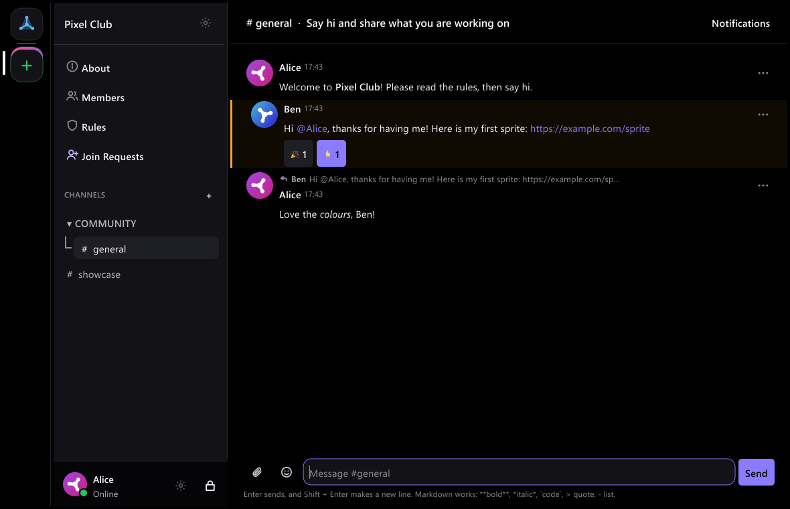

Version 0.1.2 · November 2026 · Development preview

## Contents

- [1. What is Nexus?](#1-what-is-nexus)
- [2. Getting Nexus](#2-getting-nexus)
- [3. Hosting a guild with GuildForge](#3-hosting-a-guild-with-guildforge)
- [4. Reaching your guild from the internet](#4-reaching-your-guild-from-the-internet)
- [5. Backups, moving and deleting guilds](#5-backups-moving-and-deleting-guilds)
- [6. Your user](#6-your-user)
- [7. Joining a guild](#7-joining-a-guild)
- [8. Inside a guild](#8-inside-a-guild)
- [9. Channels and messages](#9-channels-and-messages)
- [10. Calendar, Threads and Wiki](#10-calendar-threads-and-wiki)
- [11. Voice channels](#11-voice-channels)
- [12. Friends and private messages](#12-friends-and-private-messages)
- [13. Becoming a guild's owner](#13-becoming-a-guilds-owner)
- [14. Guild settings and channels](#14-guild-settings-and-channels)
- [15. Who can join, and members](#15-who-can-join-and-members)
- [16. Roles and permissions](#16-roles-and-permissions)
- [17. Ownership and leaving](#17-ownership-and-leaving)
- [18. Security and privacy](#18-security-and-privacy)
- [19. Troubleshooting](#19-troubleshooting)
- [20. Reference](#20-reference)

## 1. What is Nexus?

Nexus is a chat app in the spirit of Discord, but with **no company in the middle**. There is no central server and no account to sign up for. Instead:

#### You are a folder

Your identity is a pair of keys made on your own computer and kept in a **user folder**, together with your profile, friends and chats. Nobody can take your name or lock you out.

#### Guilds are self-hosted

A **guild** is a community, like a Discord server. Anyone can host one on their own computer with `guild-forge`: up to 8 per computer.

#### Everything is encrypted

Messages are encrypted on your computer, so even the guild's host can't read them. Every guild proves who it is with its own key, so impostors are detected.

### The programs

| Program | Who uses it | What it does |
| --- | --- | --- |
| The Nexus app | Everyone | The desktop app: create or load your user, join guilds and chat. |
| GuildForge | People who host guilds | Creates, runs and looks after guilds on a computer: a window on Windows, and the `guild-forge` commands on Windows and Debian Linux. |

### Words used in this guide

| Term | Meaning |
| --- | --- |
| User | You, in Nexus: a folder holding your keys and profile. |
| User ID | Your public key, shown as 52 letters and digits. It is your unique name in Nexus. |
| Guild | A community hosted on someone's computer. On the host's computer, it is also a folder. |
| Host | The computer (and person) running a guild with `guild-forge`. |
| Owner (ADMIN) | The user who manages a guild. The first person to pair with a new guild becomes its owner. |
| Broadcast | A one-hour window during which a guild without an owner can be paired. |
| OTP | A one-time password, like `K7Q-4MZ-9TB`, used to pair. It is valid for 5 minutes. |
| Channel | A place in a guild where members chat, like `#general`. |

## 2. Getting Nexus

Nexus is published on GitHub, at `github.com/vibe-atelier/guild-forge` under **Releases**. Each release has four programs and one notices file, all with the same version number:

| File | What it is |
| --- | --- |
| `nexus_chat-client_Windows.exe` | The Nexus app, for Windows. Everyone needs this one. |
| `GuildForge-Windows_GUI.exe` | GuildForge's window, for Windows. |
| `guild-forge_Windows-cmd.exe` | The `guild-forge` commands, for Windows. |
| `guild-forge_Debian` | The `guild-forge` commands, for Debian-based Linux such as LMDE. |
| `Third-Party_Notices.txt` | The licences of the software the programs are built with. |

### Installing the app on Windows

1. On the release page, click `nexus_chat-client_Windows.exe` to download it.
2. Make a folder for it, for example `Documents\Nexus App`, and move the file there. It is the whole app: there is nothing else to install.
3. Right-click it → *Show more options* → *Send to* → *Desktop (create shortcut)*, and open Nexus from that shortcut.

> [!TIP]
> **Windows SmartScreen.** Programs that are not code-signed may show *"Windows protected your PC"*. Click *More info → Run anyway*.

GuildForge's window is downloaded and opened the same way. Installing guild-forge on Linux is covered under [Installing guild-forge on Linux](#installing-guild-forge-on-linux), and the Linux app under [Building the app on Linux](#building-the-app-on-linux).

### Updating the app

The app only contacts GitHub when you ask. Click the **gear** at the bottom right of the welcome screen, or, once signed in, open **User Settings** and pick **Check Updates** under APP. Press **Check Updates**; if a newer version exists, press **Install Update**, then **Restart Nexus**. Your users, settings and messages stay as they are. The same gear and settings hold **Licenses**, the notices of the software Nexus is built with.

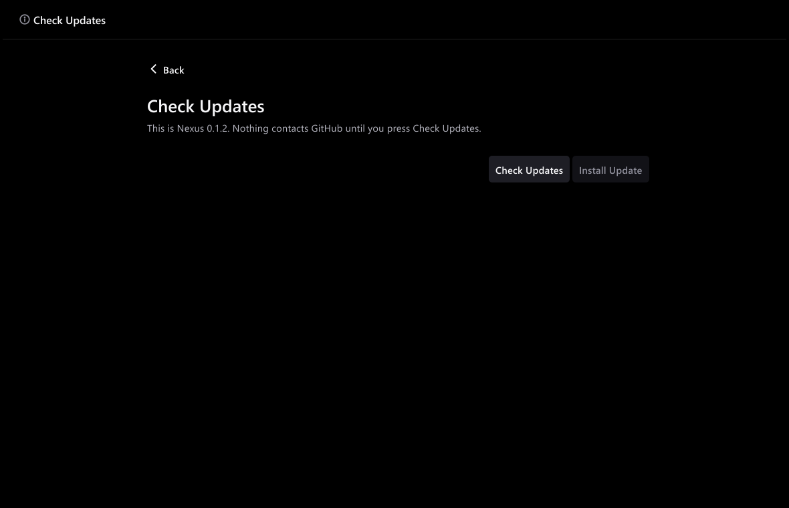

*Check Updates, opened from the welcome screen's gear.*

### The app's window

Nexus draws its own window (with Fyne), so no web browser is involved.

### Installing guild-forge on Linux

Open a **terminal** (the Linux command window) and type these one at a time, pressing **Enter** after each. Under each command, every part is explained, along with whether it only looks at your computer or changes something on it.

**1. Download it.** Replace `0.1.2` with the newest version shown on GitHub. It is one long line: type it without pressing Enter until the end.

```text
$ curl -fL -o ~/Downloads/guild-forge_Debian https://github.com/vibe-atelier/guild-forge/releases/download/v0.1.2/guild-forge_Debian
```

| Part | What it means |
| --- | --- |
| `curl` | A program that downloads files from the internet. |
| `-f` | Stops with an error if the download fails, instead of saving an error page. |
| `-L` | Follows GitHub's redirect to where the file is really kept. |
| `-o ~/Downloads/…` | Saves it in your Downloads folder. `~` means your home folder. |
| `https://…` | The file's address on GitHub. |

**Changes something:** it saves one file in your Downloads folder. It does not run it.

**2. Check it.**

```text
$ sha256sum ~/Downloads/guild-forge_Debian
```

| Part | What it means |
| --- | --- |
| `sha256sum` | Works out the file's fingerprint, a long code that changes completely if even one byte of the file is different. |

**Only reads.** The code must match the one GitHub shows next to `guild-forge_Debian` in the release. If it doesn't, delete the file and download it again.

**3. Install it.**

```text
$ sudo install -m 755 ~/Downloads/guild-forge_Debian /usr/local/bin/guild-forge
```

| Part | What it means |
| --- | --- |
| `sudo` | Runs the command as the computer's administrator. It asks for **your** password, which stays hidden while you type. |
| `install` | Copies a file and sets who may use it. It downloads and sets up nothing else. |
| `-m 755` | Everyone may run the program, but only the administrator may change it. |
| `/usr/local/bin/guild-forge` | Linux's folder for programs you add yourself, under the name `guild-forge`, so it is typed just `guild-forge`. |

**Changes something:** it adds one file, `/usr/local/bin/guild-forge`. To remove it again: `sudo rm /usr/local/bin/guild-forge`.

**4. Check it works.**

```text
$ guild-forge version
guild-forge 0.1.2
```

**Only reads.** It prints the version and stops.

### Updating

```text
$ sudo guild-forge update
Checking GitHub for a newer guild-forge...
guild-forge 0.1.2 is up to date.
```

| Part | What it means |
| --- | --- |
| `update` | Asks GitHub for the newest release. If it is newer, it downloads it, stops the running guilds, swaps the program and starts them again. |

**Changes something, only if there is a newer version:** it replaces `/usr/local/bin/guild-forge` and nothing else. It only contacts GitHub when you type it. In GuildForge's window on Windows, the gear's **Check Updates** does the same.

### Building the app on Linux

There is no ready-made Linux app in the releases yet, so on Debian-based Linux such as LMDE the app is built from the Nexus source code folder. These steps were tested on LMDE 7, and list only what that build needed. Type each command in a terminal, inside the Nexus folder unless it says otherwise.

**1. Install the build tools.**

```text
$ sudo apt install gcc libgl1-mesa-dev xorg-dev libxkbcommon-dev libwayland-dev libasound2-dev
```

| Part | What it means |
| --- | --- |
| `sudo apt install` | Installs packages from your system's store, as the administrator. It asks for your password, then lists what it will add and asks **Y/n**. |
| `gcc` | The C compiler. Parts of the app (its window, voice and video) are written in C. |
| `libgl1-mesa-dev` | Drawing with the graphics card (Mesa). |
| `xorg-dev` | The X.Org window system's libraries, for windows, the mouse and screens. |
| `libxkbcommon-dev` | The keyboard library for Wayland desktops. |
| `libwayland-dev` | Wayland, the newer window system. |
| `libasound2-dev` | Sound (ALSA), for voice channels and notification sounds. |

**Changes something:** it installs these packages and the ones they need. To see what is already installed first, without changing anything: `dpkg-query -W -f='${Package}: ${Status}\n' gcc libgl1-mesa-dev xorg-dev libxkbcommon-dev libwayland-dev libasound2-dev`.

**2. Install Go.** Download `go1.27.4.linux-amd64.tar.gz` from `go.dev/dl` (Go's official site, whose own instructions these steps follow), then:

```text
$ sha256sum ~/Downloads/go1.27.4.linux-amd64.tar.gz
$ sudo tar -C /usr/local -xzf ~/Downloads/go1.27.4.linux-amd64.tar.gz
$ echo 'export PATH=$PATH:/usr/local/go/bin' >> ~/.profile
$ source ~/.profile
$ go version
```

| Part | What it means |
| --- | --- |
| `sha256sum …` | Prints the download's fingerprint, which must match the SHA256 shown on `go.dev/dl`. Only reads. |
| `sudo tar -C /usr/local -xzf …` | Unpacks Go into `/usr/local/go`: e**x**tract a g**z**ipped **f**ile, whose name must come right after the `f`. |
| `echo '…' >> ~/.profile` | Adds Go's folder to the places your terminal looks for commands, each time you sign in. Run it once only. |
| `source ~/.profile` | Uses that setting straight away, in this terminal. |
| `go version` | Prints `go version go1.27.4 linux/amd64`. Only reads. |

**Changes something:** it adds the folder `/usr/local/go` and one line to your `~/.profile`.

**3. Build the app and put it in the menu.** In the Nexus folder:

```text
$ sh build.sh install
Built dist/linux-amd64/nexus-devclient
Built dist/linux-amd64/guild-forge
Built dist/linux-amd64/nexus
Installed Nexus: find it in your desktop's app menu or app list.
```

| Part | What it means |
| --- | --- |
| `sh build.sh` | Runs the build script, which turns the source code into the programs in `dist/linux-amd64`. The first build downloads the Go libraries the app uses and takes a few minutes. |
| `install` | Then puts the app in your desktop's menu, for you only: the program in `~/.local/bin`, its logo in `~/.local/share/icons` and its menu entry in `~/.local/share/applications`. |

**Changes something:** it writes the programs into the Nexus folder and, with `install`, three files in your home folder. It needs no `sudo` and changes nothing outside your home folder. Leave out `install` to only build.

**4. Open it** like any other app: find **Nexus** in your desktop's app menu or app list, or search for it by name. Most desktops also let you pin it to the panel, dock or desktop from there.

### Updating and removing it

The Linux app's **Check Updates** tells you when a newer version exists. To update, get the newer source code and run `sh build.sh install` again: your users, settings and messages stay as they are. To remove the app from the menu, delete the three files it added:

```text
$ rm ~/.local/bin/nexus ~/.local/share/icons/hicolor/scalable/apps/nexus.svg ~/.local/share/applications/nexus.desktop
```

**Changes something:** `rm` deletes those three files. Your users and messages are kept, in their own folders.

## 3. Hosting a guild with GuildForge

**GuildForge** creates, runs and looks after the guilds on a computer, up to 8. On Windows, open `GuildForge.exe`: its window starts on two choices. **Create Guild** is greyed out once 8 guilds exist, and **Manage Guild** until the first one does. The gear at the bottom right holds **Licenses** and **Check Updates**.

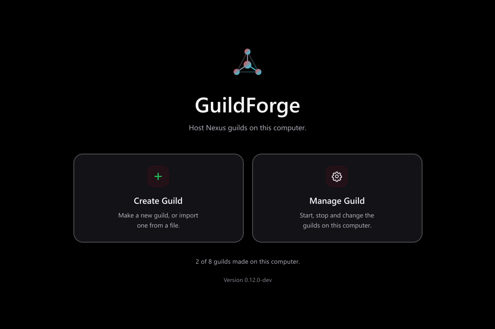

*GuildForge's home screen.*

### Create a guild

**Create Guild** has two tabs. **New Guild** asks for a password (it protects the guild's settings, exports and backups), a port (one is suggested), and optionally a folder for its files. **Import Guild** brings in a `.nexus` file exported from another computer, or a guild folder.

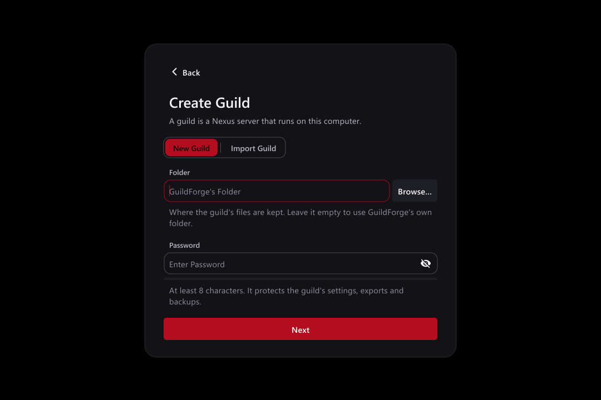

*Create Guild, New Guild tab.*

### Manage a guild

**Manage Guild** lists the guilds and their state. Pick one for its settings page: **Overview** (start or stop it, its addresses and ID), **Settings** (port, starting automatically, password), **Pairing** (broadcast and the one-time password for its first owner), **Backups**, **Export**, and **Delete Guild**.

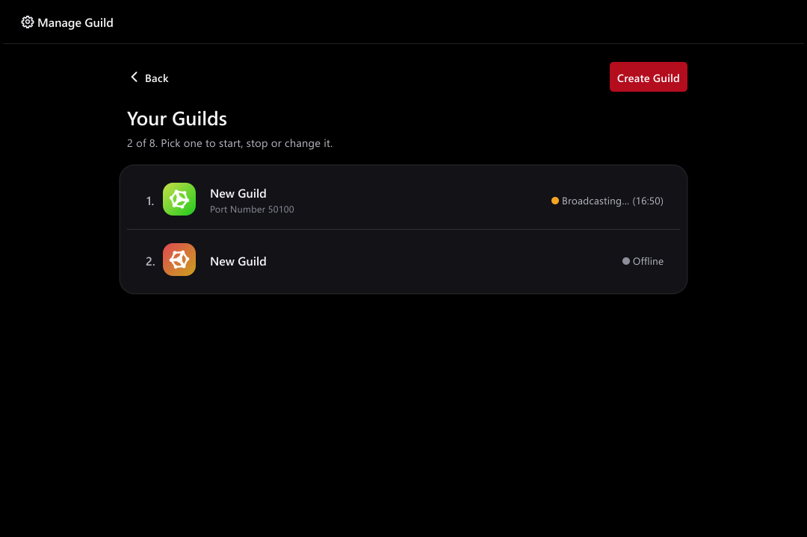

*The guilds on this computer.*

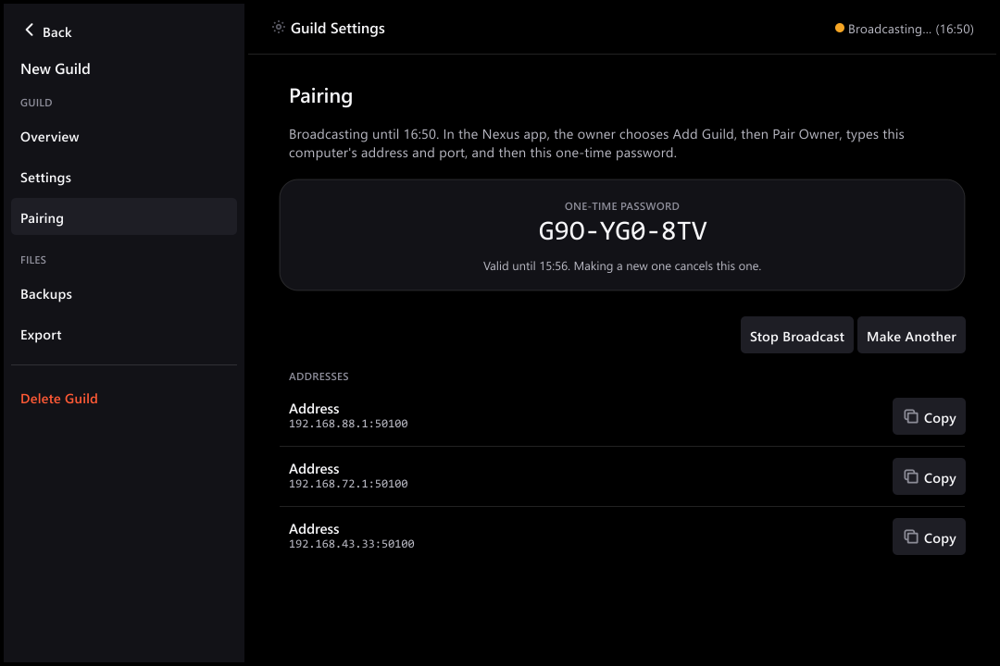

*Pairing: the one-time password the owner types in the app.*

### Terminal Commands

In a terminal, `guild-forge` does everything the window does, typed the same on Windows and Debian. On Debian it is the only way: GuildForge has no window there. Commands look like `guild-forge setup=1`, where **1** is the guild's number from `guild-forge list`. Guilds made by the old nexus-host move over by themselves the first time GuildForge runs.

> [!TIP]
> **On Linux, put `sudo` in front of every command**, for example `sudo guild-forge list`. Guilds then run as their own protected system user, `guild-forge`, and only that user and administrators can open guild folders.

### Reading a command

Every command is built the same way. Take this one:

```text
$ sudo guild-forge setup=1 port=50000
```

| Part | What it means |
| --- | --- |
| `$` | The terminal's prompt, showing it is ready. Don't type it. |
| `sudo` | Runs what follows as the computer's administrator. It may ask for **your** password (hidden while typing). |
| `guild-forge` | The program. |
| `setup=1` | What to do (`setup`, change settings) and to which guild (`1`, GUILD#1). |
| `port=50000` | Which setting, and its new value. |

> [!NOTE]
> **Typing tips.** Linux tells `Debian` and `debian` apart, so type names exactly. In a terminal, paste with **Ctrl+Shift+V**, not Ctrl+V. Pressing **Tab** finishes a file or folder name for you.

### Every command at a glance

**Only reads** commands look and change nothing. **Changes** commands change guilds or their files. The **password** is the guild's own, chosen when it was created.

| Command | What it does | Effect |
| --- | --- | --- |
| `version` | Shows guild-forge's version. | Only reads. |
| `list` | Shows every guild, its port, owner and state. | Only reads. |
| `setup=1` | Shows GUILD#1's settings. | Only reads. |
| `fall-back=1` | Lists GUILD#1's backups. | Only reads. |
| `create` | Makes a new guild and its folder. | Changes. Asks a new password. |
| `setup=1 …` | Changes one of GUILD#1's settings. | Changes. Asks the password. |
| `start=1` | Starts GUILD#1 running in the background. | Changes. |
| `stop=1` | Stops GUILD#1. | Changes. |
| `OTP` | Makes a new one-time password for pairing. | Changes. |
| `backup=1` | Saves a backup of GUILD#1. | Changes. Asks the password. |
| `fall-back=1 NAME` | Puts GUILD#1 back to a backup. | Changes. Asks the password. |
| `export=1` | Packs GUILD#1 into one locked file, for moving it. | Changes. Asks the password. |
| `import="FILE"` | Brings in an exported guild. | Changes. Asks the export's password. |
| `reset_owner=1` | Removes GUILD#1's owner. | Changes. Asks the password. |
| `delete=1` | Removes GUILD#1, asking before each step. | Changes. Asks the password. |
| `update` | Installs a newer guild-forge from GitHub. | Changes, only if there is one. |

**The first time** guild-forge runs with `sudo` on Linux, it also makes what guilds need, once: the `guild-forge` system user (who can't sign in), the folder `/var/lib/guild-forge`, and a small file telling Linux how to start a guild. `version` and `update` never make these.

### Create a guild

```text
$ sudo guild-forge create
Creating GUILD#1.

Choose a password (at least 8 characters, hidden while typing):
Type the password again:

Where should this guild's folder be?
  Press Enter for: /var/lib/guild-forge/guilds/guild-V22B745R
  or type a folder path (in double quotes if it has spaces):

GUILD#1 created.
Next step: give it a port with  guild-forge setup=1 port=50000
```

The password protects changes to the guild. Press **Enter** at the folder question to use the suggested place. A guild **is a folder**: everything about it is kept inside it.

**Changes something:** it makes the guild's folder and adds the guild to guild-forge's list. The guild doesn't run until it is started.

### Settings: one command each

```text
$ sudo guild-forge setup=1 port=50000
Password for GUILD#1:
Port set. This guild is now GUILD#1@50000.
$ sudo guild-forge setup=1
GUILD#1@50000  [stopped]
  Port:            50000
  Start on boot:   off
  Port forwarding: on (the router is asked)
```

There are no menus: each change is its own command, and asks for the guild's password first.

**Changes something:** `setup=1 port=50000` saves the new port in the guild's settings. **Only reads:** `setup=1` on its own just shows them.

| Command | What it does |
| --- | --- |
| `setup=1` | Shows the guild's settings and these commands. |
| `setup=1 password` | Changes the password. |
| `setup=1 port=50000` | Sets the port. A running guild restarts on it. |
| `setup=1 boot=on` | Starts the guild whenever the computer starts (on Windows: when you sign in). `boot=off` stops that. |
| `setup=1 broadcast` | Broadcasts for pairing an owner, and shows a one-time password (see [Becoming a guild's owner](#13-becoming-a-guilds-owner)). `broadcast=off` stops it. |

### Start, stop and list

```text
$ sudo guild-forge start=1
GUILD#1@50000 is running.
$ sudo guild-forge list
GUILD#1@50000(ADMIN:CBFSCE3CPKVUYZED…)  [running, starts on boot]
GUILD#2@50001  [stopped]
```

`list` shows each guild's number, port, owner (ADMIN) and state.

**Changes something:** `start=1` starts the guild as a background service, which Linux restarts if it ever crashes; `stop=1` stops it. **Only reads:** `list`.

> [!NOTE]
> **Guild numbers are always 1, 2, 3, …** with no gaps. If a guild is deleted, or its folder disappears, the guilds after it move up (GUILD#3 becomes GUILD#2), and `guild-forge` tells you. Check `list` before using a number.

### If the owner loses their user

The host can remove a guild's owner, so that the guild can be paired again. Members stay.

```text
$ sudo guild-forge reset_owner=1
Password for GUILD#1:
Current owner (ADMIN): CBFSCE3CPKVUYZEDB54DG27HF3DE3R3ORSNMQRPV6E5STDAOYXBQ
Remove this owner? The guild will have no owner until it is broadcast and paired again. [y/N] y
Owner removed. GUILD#1@50000 now has no owner.
```

**Changes something:** only after you answer `y`. Typing anything else, or just pressing Enter, changes nothing.

## 4. Reaching your guild from the internet

On your own Wi-Fi, people reach your guild straight away. From elsewhere, your **router** (the box that gives you Wi-Fi) stands in the way: it only lets in replies to things your computers asked for. To let people in, the router must send your guild's **port** (its door number, like 50000) to this computer. That is called **forwarding the port**.

### Automatically

While a guild runs, GuildForge asks the router to open its port, and closes it again when the guild stops or is deleted. The guild's **Overview** then lists its **ADDRESSES**, each with **Copy**:

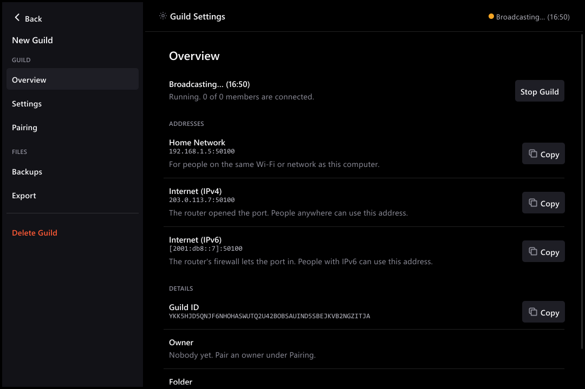

*A guild's addresses (made-up ones here).*

- **Home Network**: for people on the same Wi-Fi.
- **Internet (IPv4)**: for everyone else, once the port is open.
- **Internet (IPv6)**: the newer kind of address. It needs no forwarding, though some routers' firewalls must be told to let the port in.

Members' apps learn all of these, so they keep finding the guild when they leave home, or when your internet address changes. To stop GuildForge asking the router, turn off **Port Forwarding** in the guild's **Settings** (or `guild-forge setup=1 router=off`).

> [!TIP]
> **If the Overview says your provider shares one address among many homes (CGNAT)**, no forwarding can help over IPv4: the address belongs to your provider. This is usual on mobile data and phone hotspots. People can still reach the guild over IPv6 if both sides have it, or your provider may sell a public IPv4 address.

### Forwarding the port by hand

If the Overview says the router didn't answer or refused, set it up in the router yourself:

1. **Find this computer's home network address**: it is the **Home Network** address on the guild's Overview, without the port (for example 192.168.1.5).
2. **Open the router's settings page**: type its address in a web browser. It is usually printed on a sticker under the router, often `192.168.1.1` or `192.168.0.1`, with the user name and password to sign in.
3. **Find the forwarding page.** Routers call it **Port Forwarding**, **Virtual Server**, **NAT** or **Applications**, often under **Advanced**.
4. **Add a rule**: protocol **TCP**, external and internal port both the guild's port (like 50000), and the computer's home network address from step 1. Save it.
5. **Find your internet address** on the router's status page (often **WAN** or **Internet**). People join with it and the port, for example `203.0.113.7` and `50000`.

If the router's internet address starts with **100.64** to **100.127**, 10., 172.16 to 172.31, or 192.168, your provider shares it (CGNAT), and the rule won't help: use IPv6 instead.

### IPv6 firewall

For IPv6, look in the router's settings for **IPv6 Firewall** or **IPv6 Filter**, and allow incoming **TCP** to this computer's IPv6 address (the **Internet (IPv6)** line on the Overview) on the guild's port.

Some routers can be asked automatically only after **UPnP** is turned on in their settings; turning it on is an alternative to these steps.

### A name instead of an address

You can give people a name, like `nexus-server.com`, set up with any name (DNS) service to point at your guild's internet address. People type the name in the Link box. If you move the guild to another computer, change where the name points, and nobody has to do anything. A name doesn't hide your address, though: apps still connect straight to it.

## 5. Backups, moving and deleting guilds

### Backups

```text
$ sudo guild-forge backup=1
Saved backup S1_15112026_V1 (2.1 KB).
$ sudo guild-forge fall-back=1
Backups of GUILD#1 (newest first):
  S1_15112026_V2       2.2 KB
  S1_15112026_V1       2.1 KB
$ sudo guild-forge fall-back=1 S1_15112026_V1
```

A backup's name is `S` + the guild number + the date (`DDMMYYYY`) + `V` + the number of the backup on that day. Going back to a backup first saves the current state as a new backup, so it can be undone. A running guild is stopped and started again automatically.

**Changes something:** `backup=1` adds a backup file; `fall-back=1 NAME` puts the guild back to that backup. **Only reads:** `fall-back=1` on its own just lists the backups.

### Moving a guild to another computer

```text
$ sudo guild-forge export=1
Exported GUILD#1@50000 to:
    /home/you/GUILD1-2026-11-15.nexus  (2.4 KB)
```

The `.nexus` file is **encrypted with the guild's password**. On the other computer, run `guild-forge import="GUILD1-2026-11-15.nexus"`, then give the guild a port with `setup`. The owner, members, channels and messages come along; the port does not.

**Changes something:** `export=1` adds the `.nexus` file and leaves the guild as it is; `import` adds the guild to the other computer.

### Deleting

`guild-forge delete=1` asks for the password and a confirmation, then whether to also **erase the folder** and its **backups** (both are kept unless you say otherwise). A kept folder can be added back later with `guild-forge import="FOLDER"`. If you delete a guild's folder by hand, guild-forge notices and removes the guild from its list.

**Changes something:** each part happens only after you answer `y` to it. An erased folder can't be brought back, except from a backup.

## 6. Your user

Open Nexus from its shortcut. The welcome screen has just two choices, and the gear at the bottom right holds **Licenses** and **Check Updates**.

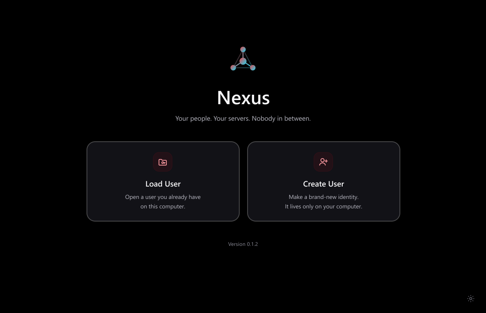

*The welcome screen.*

### Create User

Choose a name and a password (at least 8 characters), and click **Next**. Then type the password again and check the folder. It fills itself in as `Documents\Nexus\<name>`; use **Browse…** to choose another place.

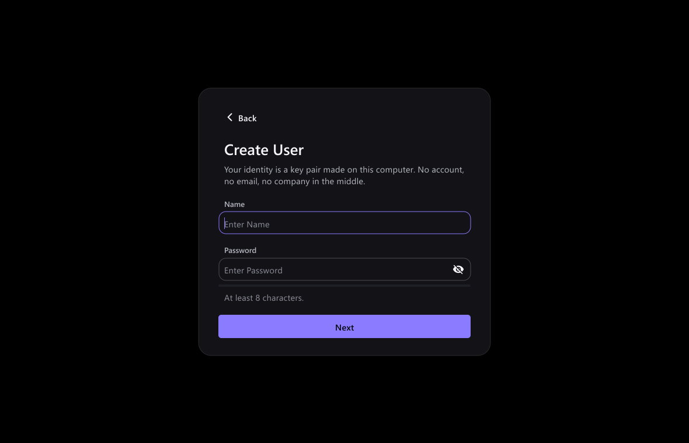

*Creating a user. The bar under the password shows how strong it is.*

> [!WARNING]
> **Remember your password.** Your private keys are locked with it. Make a **Recovery Code** (see below) as soon as you can: without the password or the code, the user cannot be opened.

### Home and your profile

After you create or load a user, you see the **Friends** page. The left rail lists your guilds, and the **+** adds one. At the bottom left are you, the **gear** (User Settings) and the **lock**.

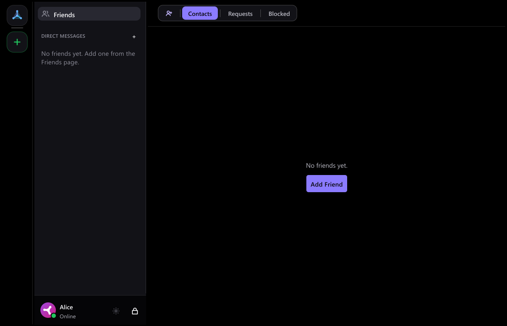

*Home: the Friends page.*

Click your name at the bottom left to see your profile: your name, a short version of your **user ID** (click it to copy the whole ID), and your status. The status list has **Online** (green), **Idle** (yellow) and **Do Not Disturb** (red). It is saved in your user folder.

### Editing your profile

**Edit Profile** (or User Settings, **Profile**) changes your name, picture, banner and bio (a short text about you, with Markdown). Everyone in your guilds and your friends see them. Until you choose a picture, you have a small network drawing in your own colours.

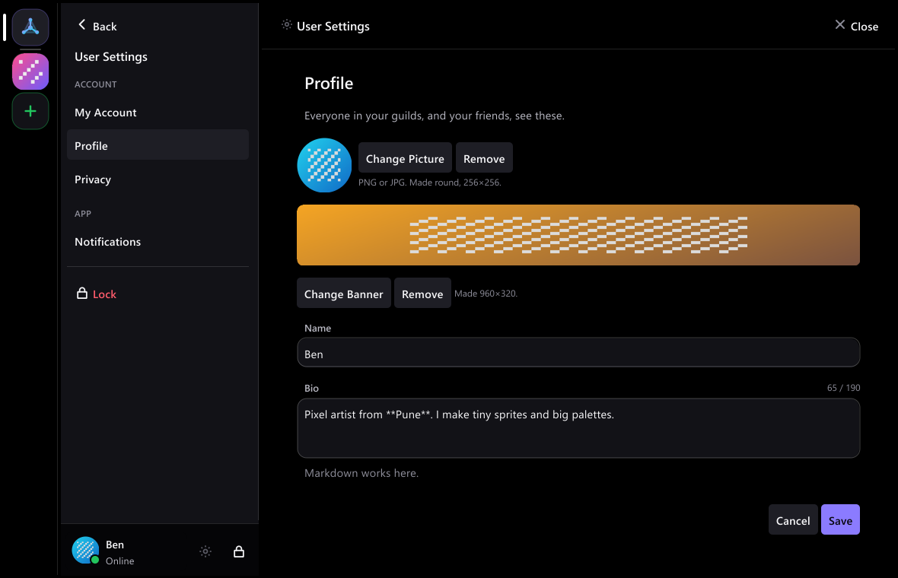

*User Settings, Profile.*

In each guild you can also have a **nickname**: the guild's gear, then **Nickname**. People with **Manage Nicknames** can change the nicknames of people lower in rank.

### Password and Recovery Code

Both are in User Settings, under **My Account**. **Password** needs your current password. **Recovery Code** makes a code of 32 letters and digits, shown only once: write it down or print it, and keep it safe. If you forget your password, click **Forgot Password** on the sign-in screen and type the code to choose a new one. Making a new code stops the old one working.

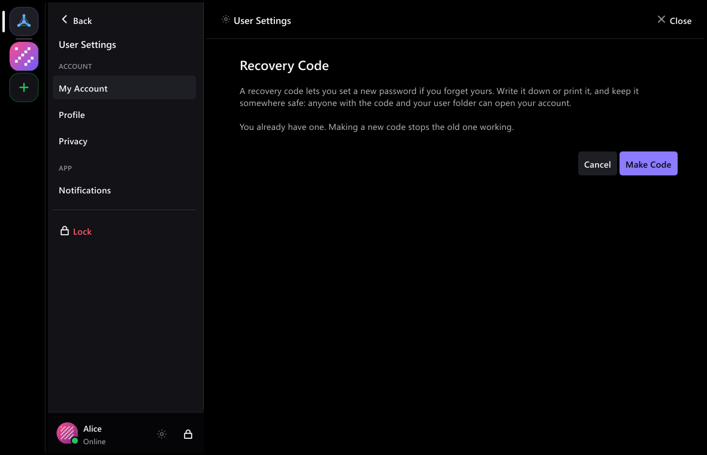

*Making a recovery code.*

### Notifications and sounds

When the Nexus window isn't in front, Windows (or Linux) shows a pop-up for **mentions** of you or your roles, **replies** to your messages, and **private messages**. **Notifications** above a chat chooses **All Messages**, **Mentions Only** or **Nothing** for that channel; the guild's gear, then **Notifications**, does it for the whole guild. Guilds remember these choices, which categories you folded and what you have read, so they follow you to another computer. A short sound plays for new messages; turn off **Sounds** in User Settings, under Notifications.

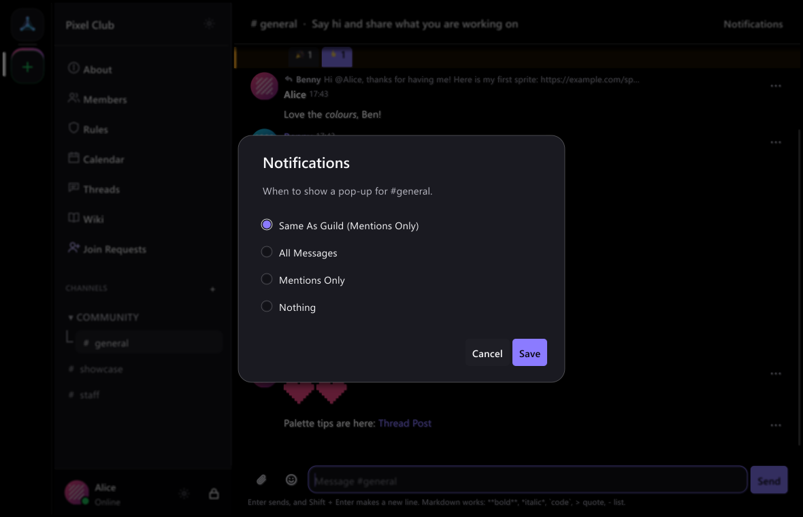

*Notifications for one channel.*

### Lock and Load User

The **lock** button (bottom left) signs you out and clears your keys from memory. **Load User** lists the users opened before on this computer; you can also **Browse…** to a user folder, or type its path.

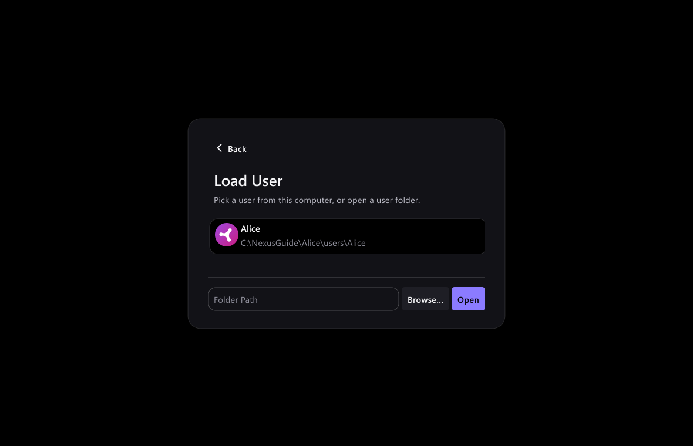

*Load User. Hover over a user and click × to remove it from the list (the folder itself is not touched).*

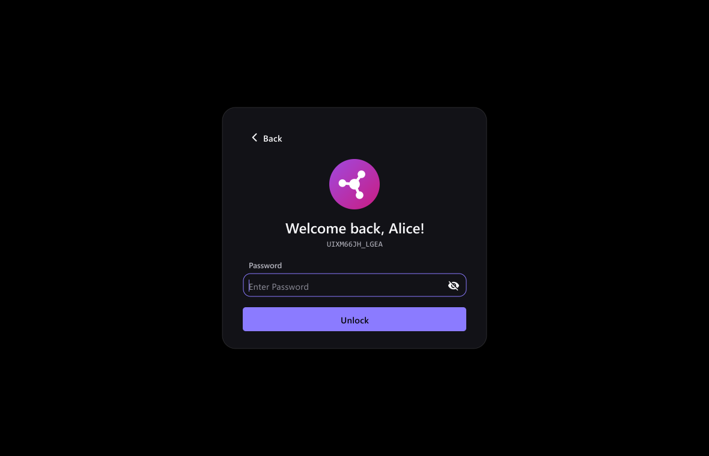

*Unlocking a user.*

## 7. Joining a guild

Anyone with a guild's **address and port** can ask to join. Click the green **+**, stay on the **Join** tab, type the address in **Link (IP Address)** and the port in **Port**, and click **Check**. (You can also type both in the first box, like `127.0.0.1:50000`; the Port box is then ignored.)

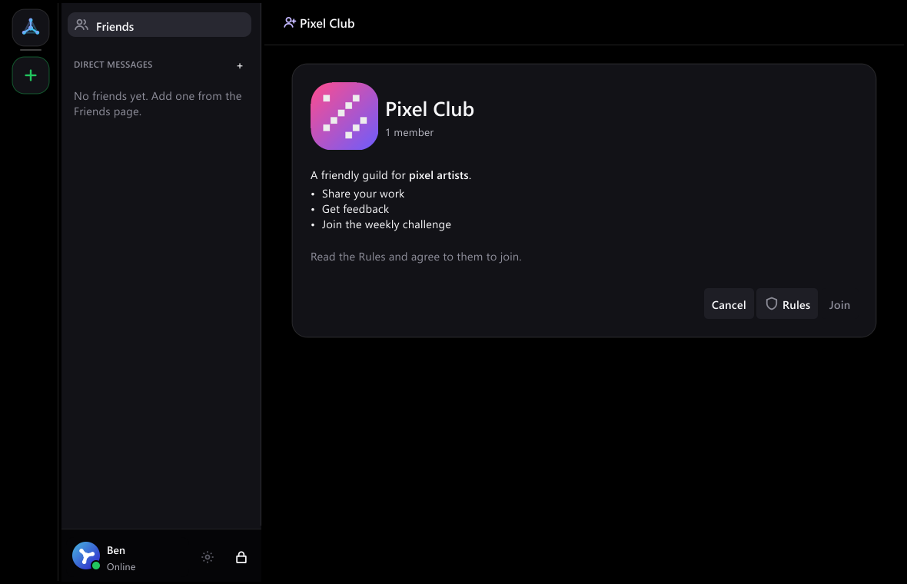

*After Check, the guild's About page fills the window, with Cancel, Rules and Join.*

**Rules** opens the guild's Rules as a full page. If the guild asks you to agree to them, **Join** stays grey: open the Rules, scroll to the end, and click **I Agree**. If the guild has a password, type it in **Guild Password**. After **Join** come the guild's questions, if it has any, and then, if the owner approves new members, your request waits for them. If you don't meet a rule (for example, an invite-only guild), Nexus tells you why.

### The questions

If the guild has a CAPTCHA, you answer its questions one page at a time, in the main area. Once you move on, you can't change an answer. The choices are shuffled each time.

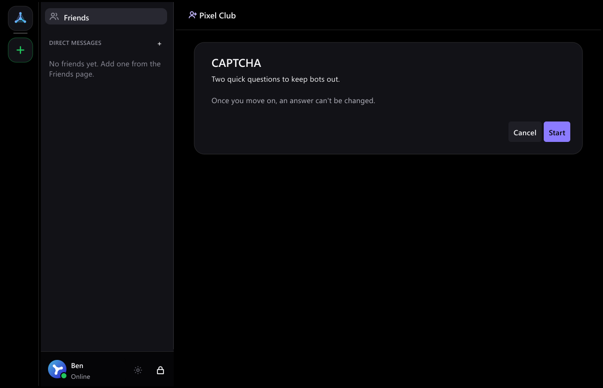

*The owner's welcome, then one question per page.*

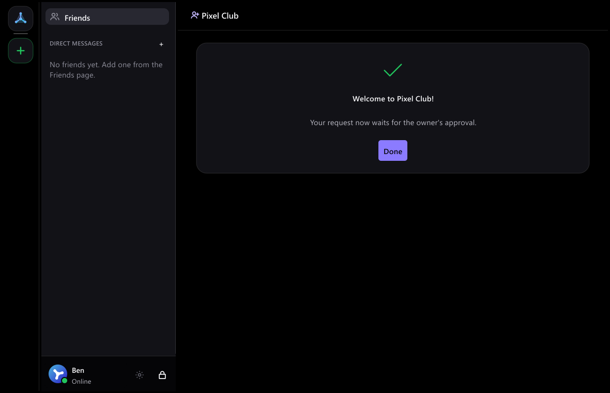

*Passed, with the owner's own message.*

- Nexus only tells you whether you passed, not which answers were wrong.
- After **3 failed tries**, you must wait **24 hours** before trying again.

### Waiting for approval

If the owner approves new members, the guild appears grey in your list with *Waiting for the owner's approval*. As soon as the owner accepts you, it turns to colour by itself. **Cancel Request** removes it from your list.

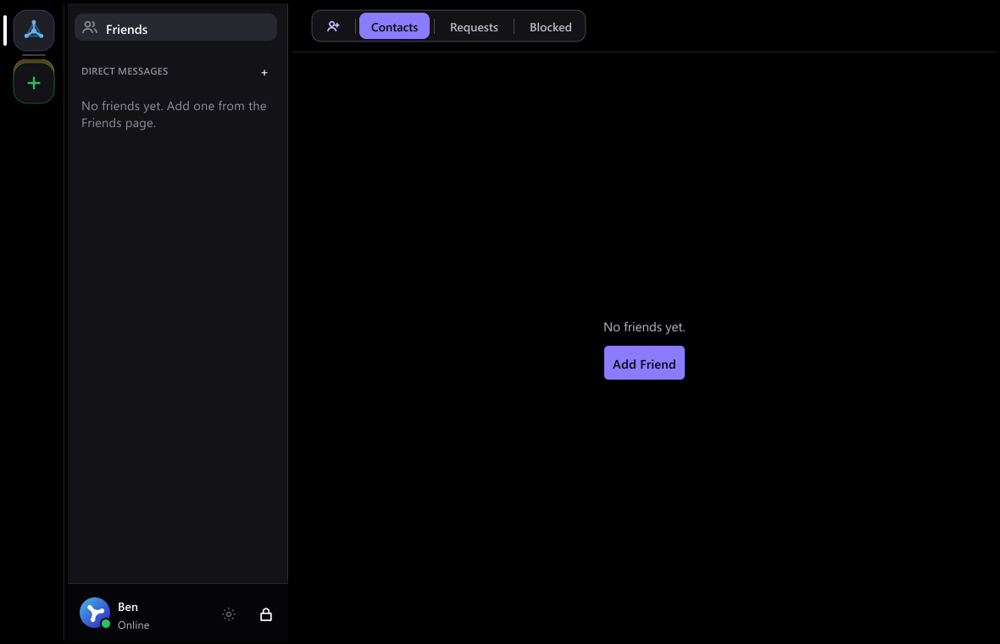

*Waiting for the owner's approval.*

If you are later removed from a guild, it shows *You were removed from this guild*, with a button to remove it from your list.

## 8. Inside a guild

### The About page

Every guild has an About page: its picture, name, number of members and About text, with **Copy Address** to invite people. The About text can use Markdown, such as ****bold**** and lists. People who help run the guild also see a strip with join requests waiting and **Server Settings**.

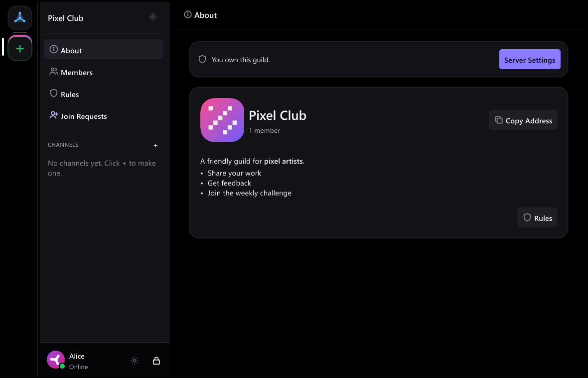

*A guild's About page.*

On the left, under the guild's name, are **About**, **Members** (the owner has a crown), **Rules** (if the guild has them), **Join Requests** (for staff) and the guild's **channels**. Channels can sit in **categories** (names in capitals) and in **folders** (with a folder icon), and lines show what is inside what. If the guild has Rules, the About page also has a **Rules** button that opens them on their own page.

### Server Settings

The **gear** next to the guild's name opens its **Server Settings** page. The categories are on the left, in groups. Everyone has **Nickname** and **Notifications**; people who help run the guild see the categories they may use. **Leave Guild** is at the bottom.

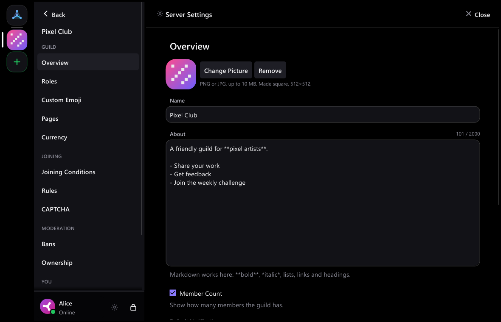

*Server Settings, as the owner sees it.*

### When a guild can't be reached

The app keeps a live connection to each guild. If a guild stops, or its computer is off, its picture turns **grey**; hover over it to see why. Nexus keeps trying, and the guild turns back to colour by itself when it can be reached again.

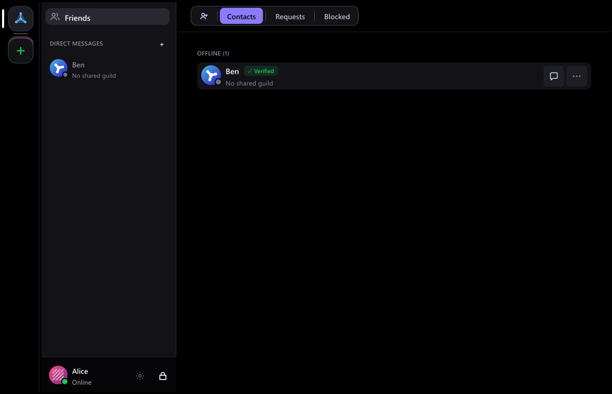

*An offline guild. Its name and picture are still shown.*

### One computer at a time

You can use the same user on several computers, but each guild talks to **only one of them at a time**. On the other computer, the guild is grey with *Active on another computer* and a **Use Here** button that moves it over.

## 9. Channels and messages

Click a channel on the left to open it. Type in the box at the bottom and press **Enter** to send; **Shift + Enter** starts a new line.


*A channel: a reply, a reaction and a mention.*

### What you can do with a message

Each message has a **⋯** button on the right. It opens a menu:

| Menu Item | What it does |
| --- | --- |
| React | Adds an emoji under the message. Click an emoji under a message to add or remove yours. |
| Reply | Your message shows the start of the message it answers. |
| Edit | Changes your own message; it then shows *(edited)*. **Esc** cancels. |
| Delete | Deletes your own message. People with **Manage Messages** can delete anyone's. |

### Mentions

Type **@** and the start of a name, then pick the person from the list. They see the message highlighted, and a red number on the channel if they weren't looking at it.

### Formatting (Markdown)

| You type | You get |
| --- | --- |
| `**bold**` | **bold** |
| `*italic*` | *italic* |
| `~~struck out~~` | ~~struck out~~ |
| ``code`` | `code` |
| `> quote` | a quoted block |
| `- item` or `1. item` | a list |
| `[text](https://…)` | a link; links open in your normal web browser |

### Catching up

Messages arrive straight away. Channels with new messages are shown in **bold**, and messages sent while your app was closed are there when you open it. Scroll to the top and click **Load Earlier** to load more.

### Encryption

Every message is encrypted on the sender's computer with the channel's key, and signed by its author. The guild stores the messages but **cannot read them**. Your app gets each channel's key from other members automatically. A 🔒 next to a channel means your app is still waiting for its key: it arrives when a member who has it comes online.

### Pictures and files

The **paper clip**, next to the message box, sends a picture or any file of up to 2.8 MB. Pictures show in the chat; click a file's name to open it. Files are encrypted with the channel's key, just like messages.

### Custom emoji

A guild can have up to 50 emoji of its own (Server Settings, **Custom Emoji**, for people with **Manage Guild**). Click the **smiley face** by the message box, or type `:name:`. You can use the emoji of every guild you're in, everywhere: the guild you use it in gets a copy, so everyone there sees it. A message of only emoji shows them big, and the message's **⋯** → **React** lists them too.

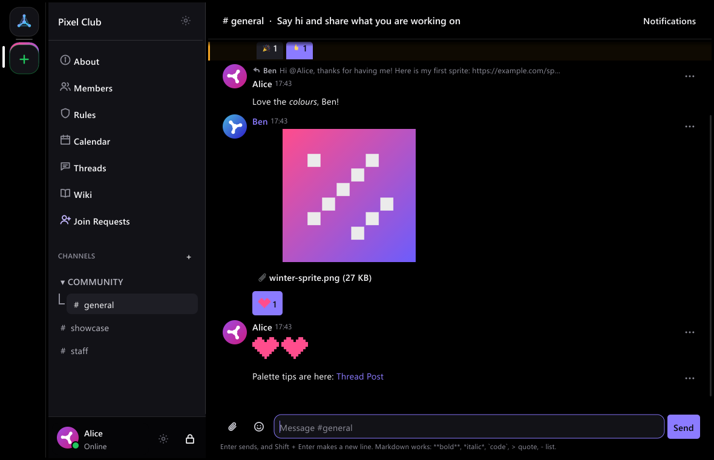

*A picture, big emoji, a custom reaction and a link to a Thread post.*

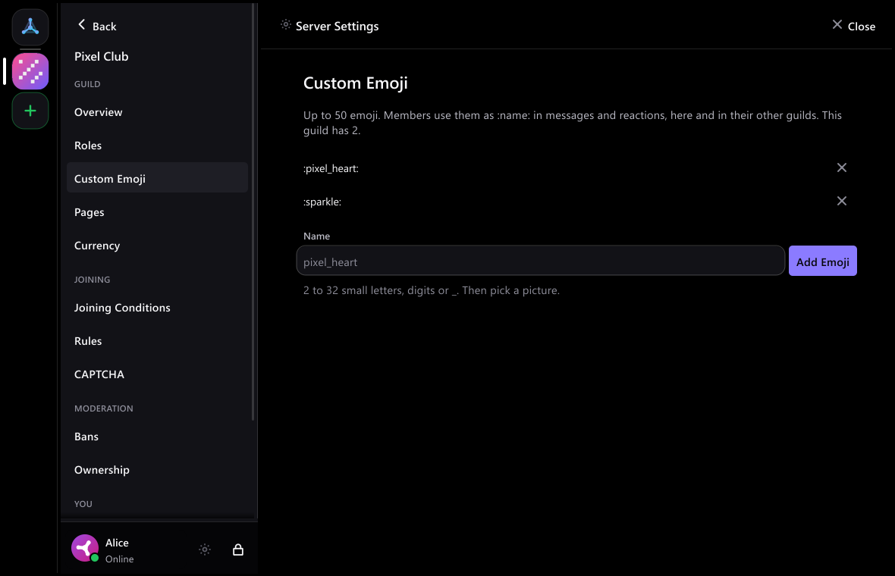

*Server Settings, Custom Emoji.*

## 10. Calendar, Threads and Wiki

A guild can have three more pages, listed under **About** in its side bar. People with **Manage Pages** turn them on in Server Settings, under **Pages**. Unlike channels, these pages are readable by the guild's host.

### Calendar

The month, with the days that have events marked, and the month's events below it. Use the arrows for other months. Click an event to read its details. People with **Manage Events** use **New Event**: a title, a start date with an optional time and time zone, an optional end, and details in Markdown. Times are shown in the time zone they were written in.

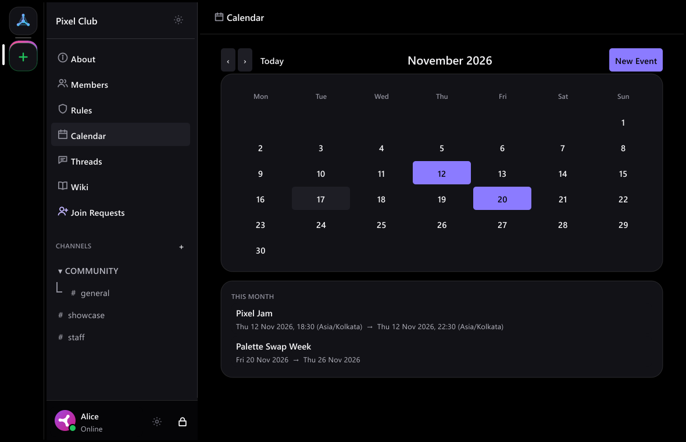

*The Calendar.*

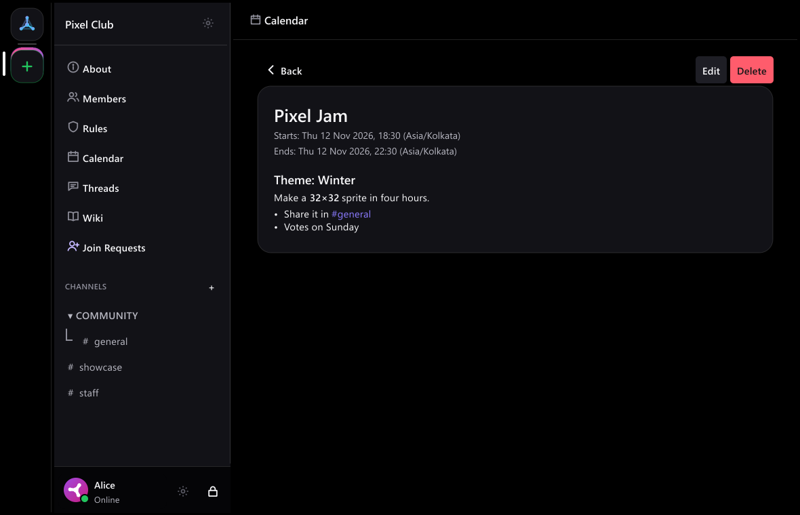

*An event's page.*

### Threads

Posts with comments, newest first. Like 👍 or dislike 👎 each post or comment once (click again to take it back). **Reply** answers a comment; replies are indented under it. You can edit and delete your own posts; people with **Manage Pages** can delete anyone's. **Copy Link** copies a link to a post that you can paste in a chat.

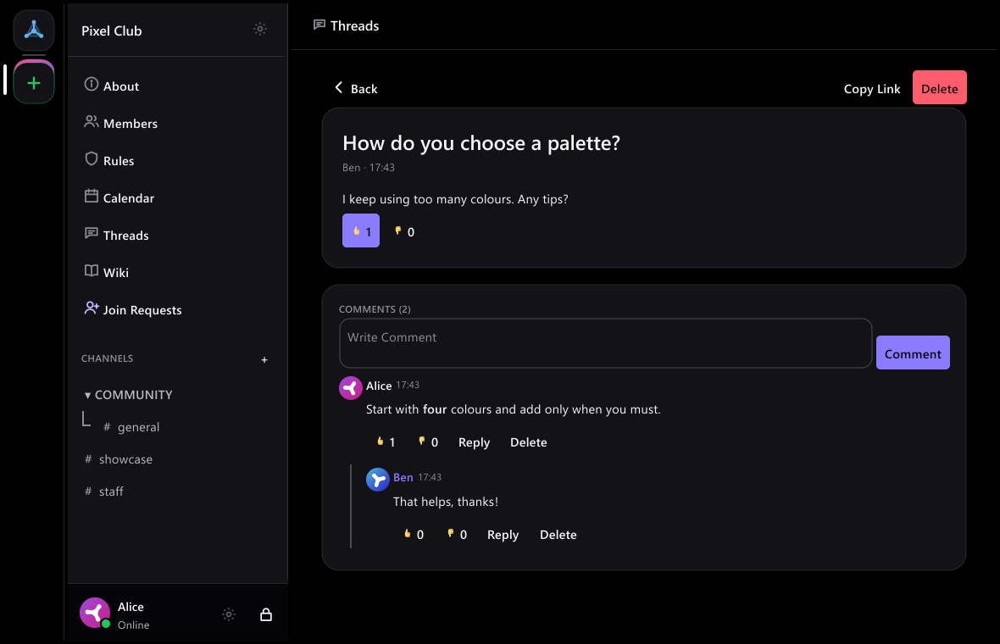

*A post, a comment and a reply.*

### Wiki

Pages of knowledge, listed under their headings. People with **Edit Wiki** make and change them. In a page, `[[Page Title]]` links to another Wiki page and `#channel-name` to a channel.

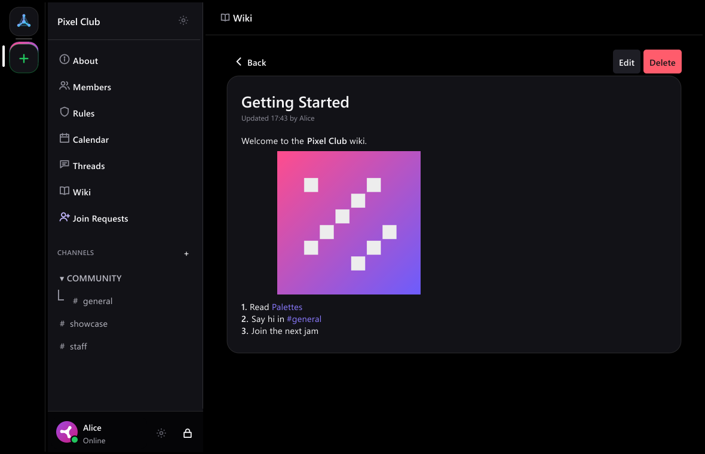

*A Wiki page with a picture and links.*

### Pictures

In the Rules, events, posts and Wiki pages, **Add Picture** uploads a picture to the guild and puts it in the text. Pictures are only ever shown from the guild, never from other websites, so reading a page never tells another website your address.

### When the Rules change

If you joined by ticking *"I agree to follow these rules"* and the Rules change later, the About page tells you, once. By staying a member you agree to the new Rules; **Rules** shows them, and **OK** hides the notice.

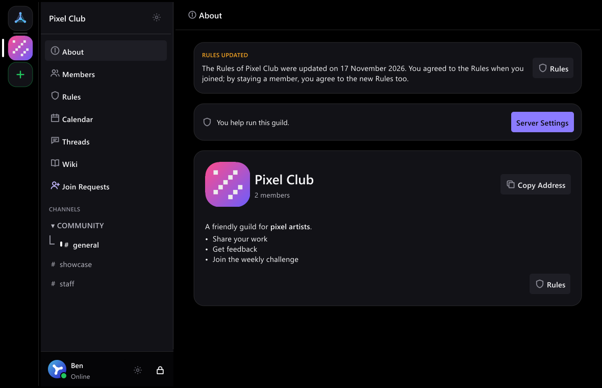

*The notice Ben sees after the Rules changed.*

### Wallet and Shop

A guild can have its own currency (Server Settings, **Currency**, for people with **Manage Currency**): a name like *Pixels*, an icon, and an optional **Shop**. It is not real money. Staff make coins into the guild's bank and give them to members from **Wallet** → **Bank**.

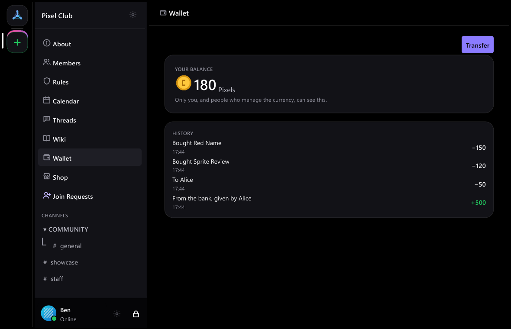

*Ben's Wallet: his balance and history. Only he and the staff can see it.*

To pay someone, click **Transfer** in your Wallet or in their member window, or type `/transfer @name 50` in a channel. Nexus always asks before sending. `/balance` shows what you have. A message that starts with `/` is a command and is never sent; to send one that starts with `/`, begin it with `//`.

In the **Shop**, **Buy** pays for an item; the coins go back to the bank, and the staff see who bought what in the Bank and deliver it. A **Role** item is yours as soon as you buy it: the Shop then shows **Equip** or **Unequip**. Some roles can't be worn together (a guild selling coloured names, for example), so equipping one takes the other off.

Some items are **auctioned** instead: where the price would be is the highest bid so far, with the **Highest Bidder** and when the auction ends under the description. **Bid** shows your balance and the current bid; your bid is taken from your wallet and held, and comes straight back if someone bids more. When the auction ends, the highest bidder has the item (a Role at once; staff deliver other things). Staff choose **Sale Type: Auction** with a starting bid and an end time when making an item.

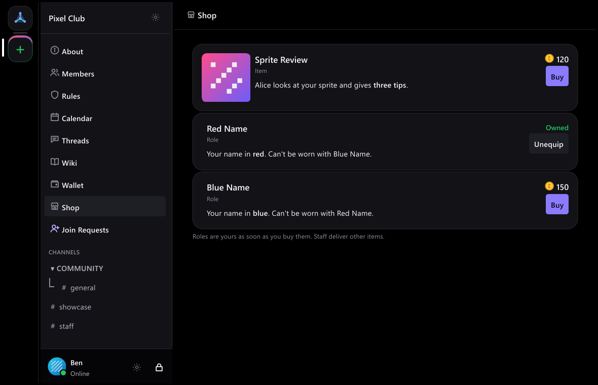

*The Shop.*

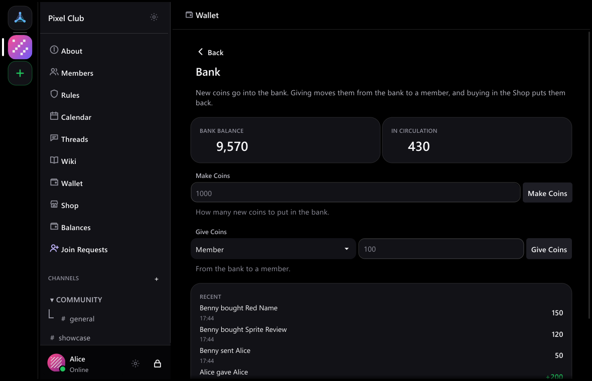

*The Bank, for staff: Bank Balance, In Circulation, and making and giving coins. Every member's balance is on the Balances page.*

### Polls, spoilers and more

The clock by the message box has **Create Poll**, **Schedule Message**, **Disappearing Message**, **Scheduled Messages** and **Pinned Messages**. **Pins** at the top of a chat, with how many there are, also opens the pinned messages.

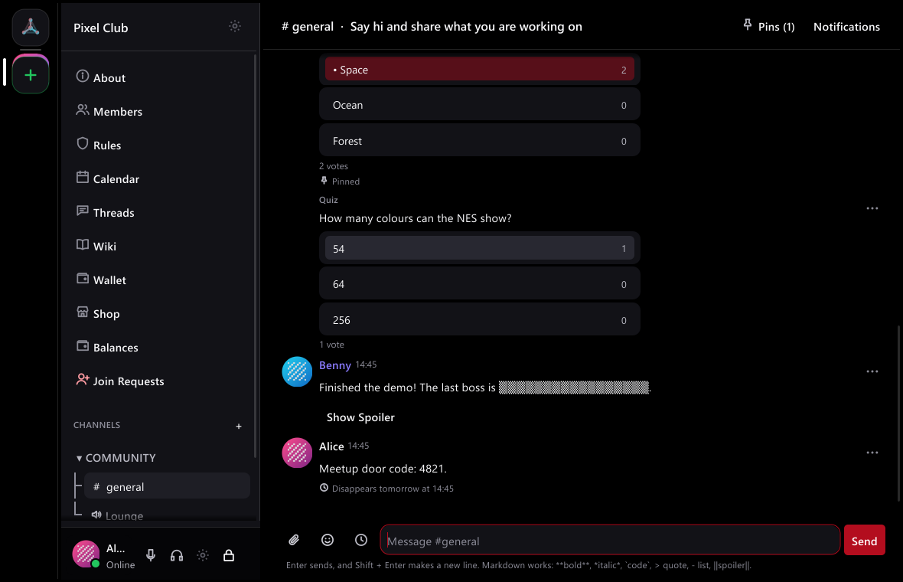

*A forwarded message, a pinned poll, a quiz, a spoiler, and a message that disappears.*

- **Polls** have 2 to 10 choices. Click a choice to vote, and again to take it back. In **Quiz Mode** one choice is right: it shows once you answer, and an answer can't be changed.
- **Spoilers**: write `||like this||`; it stays hidden until **Show Spoiler**.
- **Schedule Message**: choose a time, then write and Send. The guild posts it then, even if your computer is off. **Scheduled Messages** lets you cancel it until then.
- **Disappearing Message**: your messages delete themselves after 1 hour, 1 day or 1 week, until you choose Off.
- A message's **⋯** has **Forward** (to any channel you can write in, or a friend), **Pin** (with the Pin Messages permission) and, once it was edited, **Edit History**.
- **Slow Mode**, in a channel's Messages settings, lets each member send one message every so often.

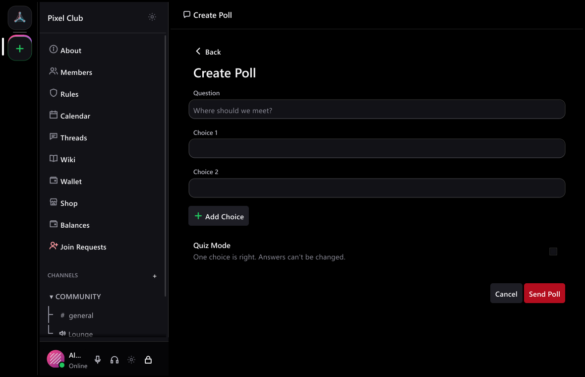

*Create Poll.*

The guild still can't read any of it: questions, choices, spoilers and forwarded messages stay sealed. It knows only what it needs, such as who voted and when a message disappears.

## 11. Voice channels

A **voice channel** is for talking. Make one with the **+** by CHANNELS and the Kind **Voice Channel**; it shows with a speaker icon. Click it, then **Join Voice**. Everyone in it is listed under its name, with a green ring while they talk. You can be in one voice channel at a time.

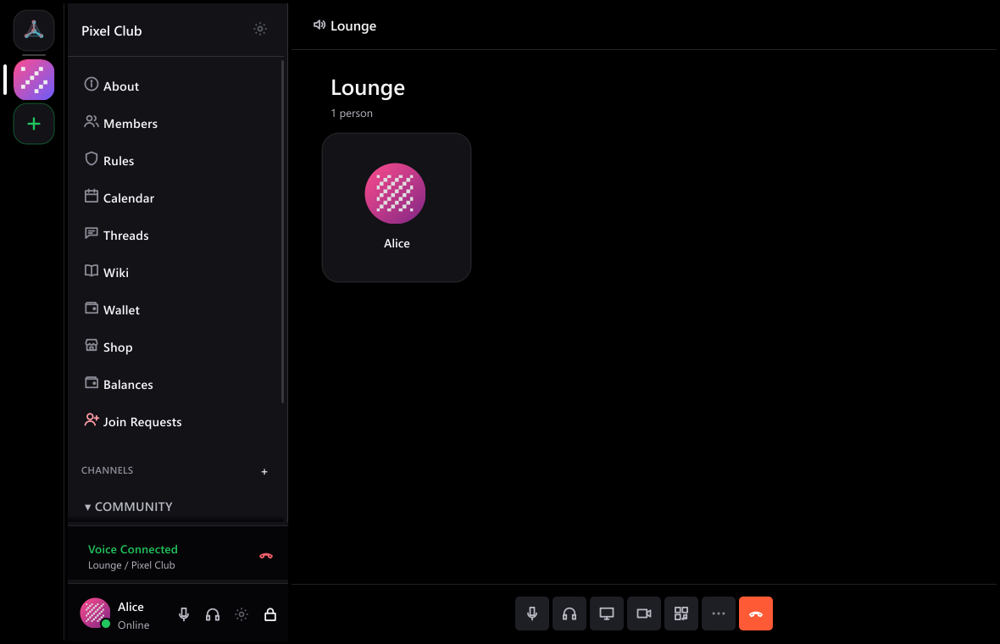

*In a voice channel. The bar above your name says where you are; the red phone leaves.*

Once you have joined, the voice page's buttons are icons in a row at the bottom of the window (each says what it does when you rest the pointer on it): **mute**, **deafen** (you hear nothing, and are muted too), share your screen, your camera, the soundboard, **⋯** for more (such as Lock Channel), and the red phone to leave. The microphone and headphones by your name do the same. Voice is sealed with the voice channel's key, like messages, so the guild passes it on without being able to hear it.

### Voice settings

User Settings, **Voice**: choose your microphone and speakers. By default your microphone sends whenever you are louder than **Input Sensitivity**: talk, and set it just below where the bar turns green. Under **VOICE PROCESSING**, **Echo Cancellation** (for speakers instead of headphones) and **Automatic Gain** are on unless you turn them off. **Noise Suppression** is **Strong** (RNNoise, trained on real noise such as typing, fans and traffic), **Standard** (lighter on the computer) or **Off**. Or turn on **Enable Push-To-Talk** and hold a key (``` unless you choose another) while you talk. On Windows the key works even when another window is in front. **Soundboard Volume** sets how loud soundboard sounds are for you.

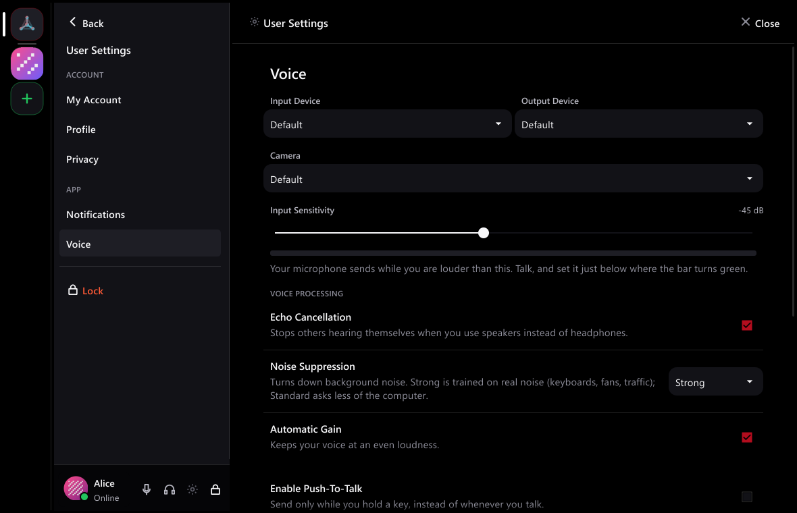

*User Settings, Voice.*

### Sharing your screen

In a voice channel, **Share Screen** lets the others see your screen, or one window. Choose it from the **Screens** or **Windows** tab, pick **720p** or **1080p**, and leave **Share Sound** on to send what your computer plays (a video's sound, a game's). Your microphone still goes through voice as usual, and the call itself isn't sent back. **Go Live** starts it.

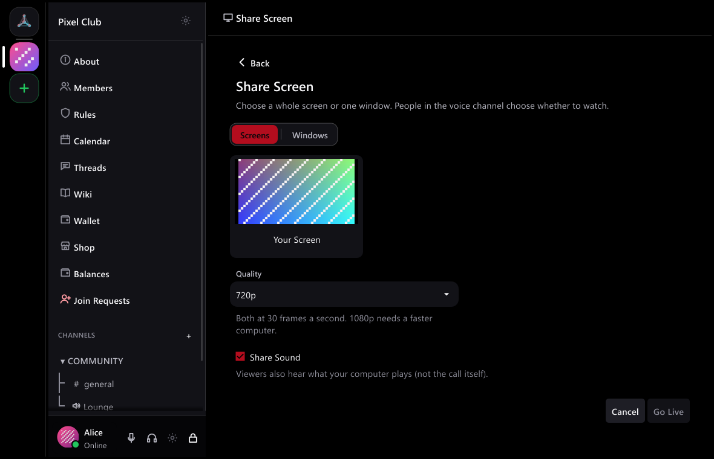

*Share Screen.*

Others see **LIVE** by your name and choose **Watch**; your screen then shows above the people in the channel. Like voice, the picture is sealed with the voice channel's key, so the guild passes it on without seeing it, and only to people watching.

In User Settings, **Voice**, you can choose a **Push-To-Blur** and a **Push-To-Mute** key. While you hold the first, your shared screen is blurred so nothing on it can be made out; while you hold the second, the sound you share goes silent (your microphone keeps working). They are for moments you don't want shown or heard, like something private on screen or music you may not share.

### People in a voice channel

Click someone's tile on the voice page to see their **Volume**: from 0 to 200%, only for you, and remembered for that person. While someone shares their screen, their tile shows a small picture of it, about every 5 seconds, so you can see what it is before choosing **Watch**.

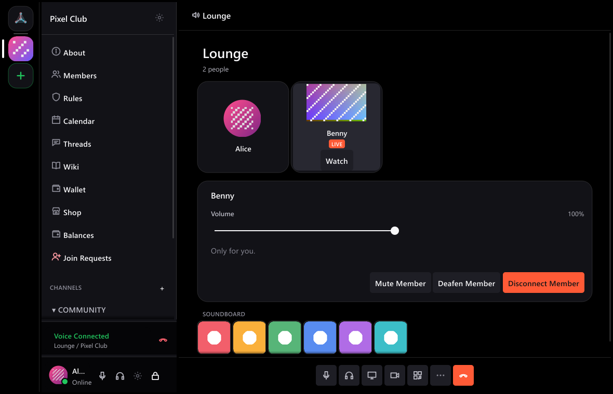

*Ben's tile, chosen: his volume, and what a moderator may do.*

Moderators see more, for people ranked below them, each with its own permission: **Mute Member** and **Deafen Member** (which only a moderator can lift, even if they leave and come back), **Move Member** to another voice channel, and **Disconnect Member**. **Lock Channel** stops anyone new joining until it is unlocked. Someone with **Priority Speaker** can choose a **Priority Speaker Key** in User Settings, Voice: while they hold it and talk, everyone else is quieter.

### The soundboard

A guild can have up to 25 short sounds, each up to 10 seconds. Someone with **Manage Soundboard** adds them in Server Settings, **Soundboard**: a name, a picture for its button if wanted (**Choose Picture**), then **Choose File** for a WAV or Ogg Opus file. In a voice channel, the soundboard button at the bottom (or **⋯**, Show Soundboard) opens them as square pictures; rest the pointer on one for its name, and click to play it to everyone there.

### Cameras

In a voice channel, **Start Camera** turns your camera on. Your camera then shows on your tile for everyone in the channel, like an online meeting; nobody needs to click Watch. Choose which camera in User Settings, **Voice**. Like voice, it is sealed with the voice channel's key.

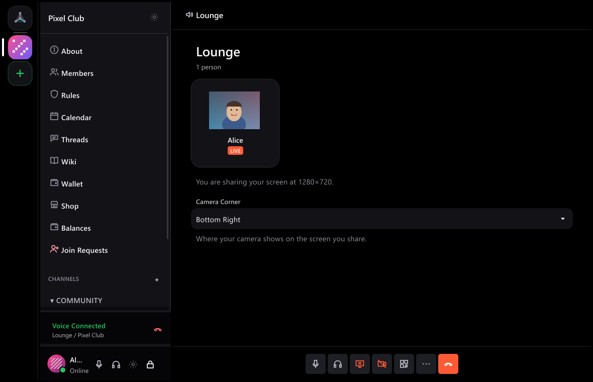

*Camera on while sharing (a made-up camera here).*

If you share your screen with your camera on, your camera is drawn into a corner of your shared screen, so viewers see both. **Camera Corner** on the voice page picks the corner, even while you are live.

## 12. Friends and private messages

Private messages are between two **friends**. They travel through a guild you both belong to, sealed so that only the two of you can read them.

### Adding a friend

In a guild's member list, click **⋯** next to someone, then **Add Friend**. Or, on the Friends page, open the Add Friend tab (the icon at the left of the tabs) and paste their user ID (from their profile). They see your request in the **Requests** tab and can **Accept** or **Decline**. Until they accept, neither of you can send messages.

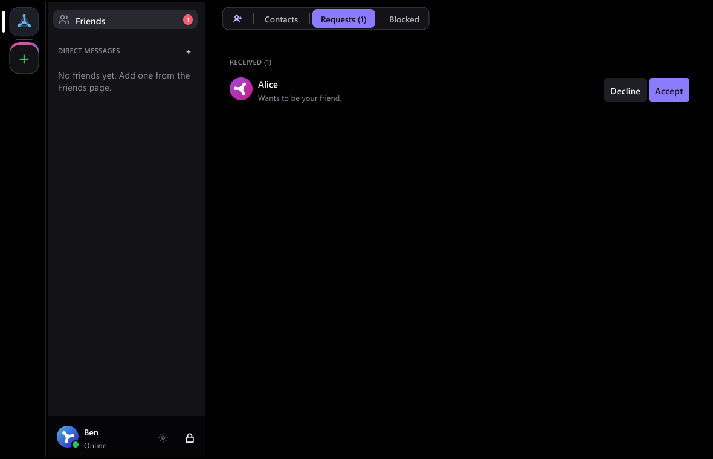

*Ben sees Alice's request in the Requests tab.*

The **All** tab lists every friend, online ones first, grouped by status and in name order. The **Blocked** tab lists the people you blocked.

### Chatting

Click a friend to open your chat. It works like a channel: Markdown, replies, reactions, editing and deleting (the **⋯** next to a message), and typing. The **paper clip** sends a picture or file of up to 2 MB. Ticks next to your messages show how far they got: **one grey tick** when sent, **two grey ticks** when your friend's app received it, and **two red ticks** once they read it (they can turn reading ticks off in User Settings, Privacy, **Read Receipts**). The smiley adds emoji.

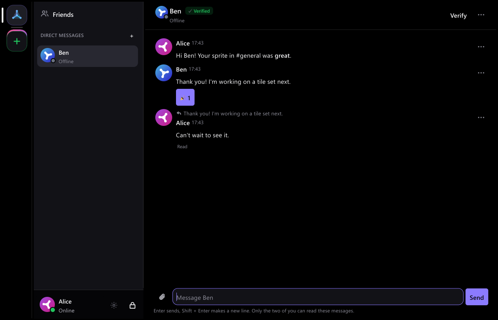

*A private chat, with a reply, a reaction, ticks, and the Verified badge.*

- If your friend is offline, the guild keeps your message (sealed) for up to **30 days** and delivers it when they come back.
- If you no longer share any guild, your friend turns grey and you can't send until you share one again.
- Your chats are kept on your computer, encrypted, in your user folder.

### Verifying a friend

To be sure a friend is really who they say, use **Verify** at the top of your chat. Their app shows a 9-character code for you (like `K7Q-4MZ-9TB`); they tell it to you in person or on a call, and you type it under **Their Code**. If it matches, a **✔ Verified** badge appears next to their name. Your app shows your own code for them in the same window. If their keys ever change, the badge turns into **⚠ Key Changed**: verify them again before trusting them. Once verified, the same place offers **Remove Verification**.

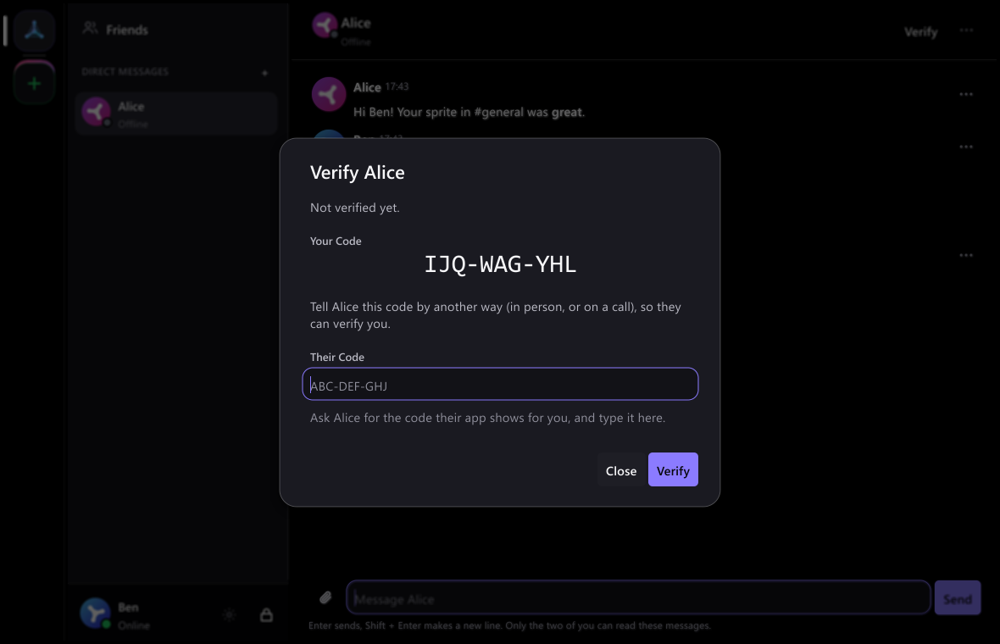

*Ben's code for Alice.*

### Notes, removing and blocking

The **⋯** at the top of a chat has **Note** (a private note only you see), **Copy ID**, **Remove Friend** and **Block**. A blocked person can't send you messages or requests, and their messages in guild channels are collapsed for you. They aren't told. The **Blocked** tab on the Friends page shows them, with **Unblock**.

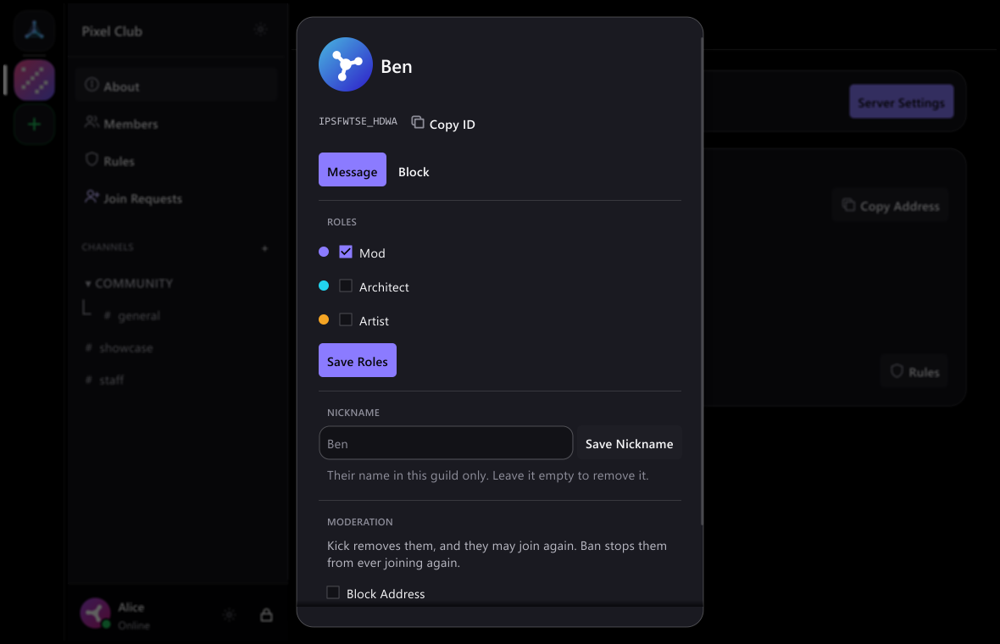

*A member's ⋯ has Message (or Add Friend) and Block.*

## 13. Becoming a guild's owner

A new guild has no owner. Pairing makes you its **owner (ADMIN)**. You need the guild's computer and the app.

1. **On the guild's computer**, start a broadcast: `guild-forge setup=1 broadcast` (or Pairing in GuildForge's window). It shows a one-time password.

   ```text
   GUILD#1@50000 is broadcasting until 18:42 (1 hour).
   
   One-time password for GUILD#1@50000:
   
       BT7-3ZI-P2B
   
   Valid for 5 minutes (until 17:47). Making a new one cancels this one.
   In the client, enter this computer's address and port, e.g.:
       192.168.1.20:50000
   ```


   A fresh one-time password any time: `guild-forge OTP`.

2. **In the app**, click the green **+**, choose the **Pair Owner** tab, type the address and port, and click **Check**. Then type the one-time password and click **Pair**.

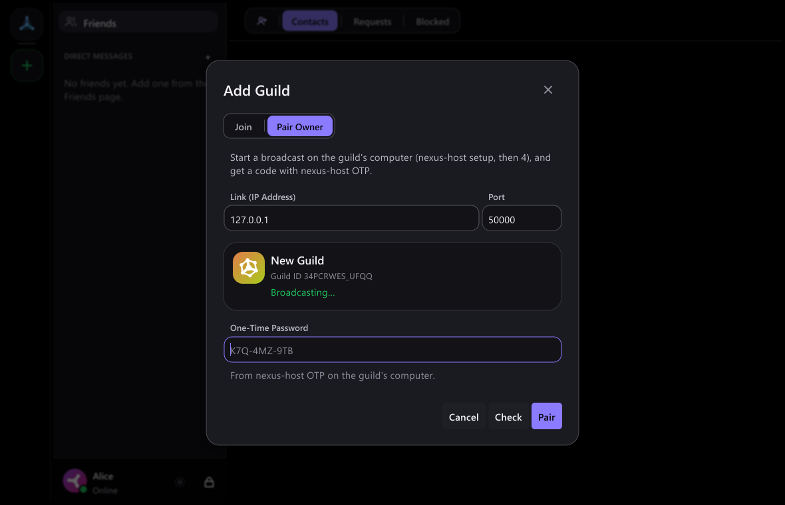

*Pairing as owner. *Check* shows the guild and whether it is broadcasting.*

- Capital letters and dashes in the code don't matter.
- After **5 wrong codes**, the broadcast ends; start a new one.
- A broadcast lasts **1 hour**. Only one guild per computer can broadcast at a time.
- The code travels inside the encrypted connection, so nobody on the network can read it.

## 14. Guild settings and channels

### Server Settings

Right after pairing, **Server Settings** opens on **Overview** so that you can name the guild. Later, open it with the gear next to the guild's name.


*Overview: picture, name, About text, the member count, default notifications and the guild's details.*

Pictures can be PNG or JPG files of up to 10 MB; Nexus crops them to a square and shrinks them to 512×512. Names can be up to 64 characters long, and the About text up to 2,000.

### Making channels

Click the **+** next to **Channels**. There are three kinds:

- **Category**: a heading that groups channels, like COMMUNITY.
- **Folder**: a group that can be folded away, inside a category or another folder (up to 3 deep).
- **Channel**: where people chat. Its **Topic** is shown at the top of the chat.

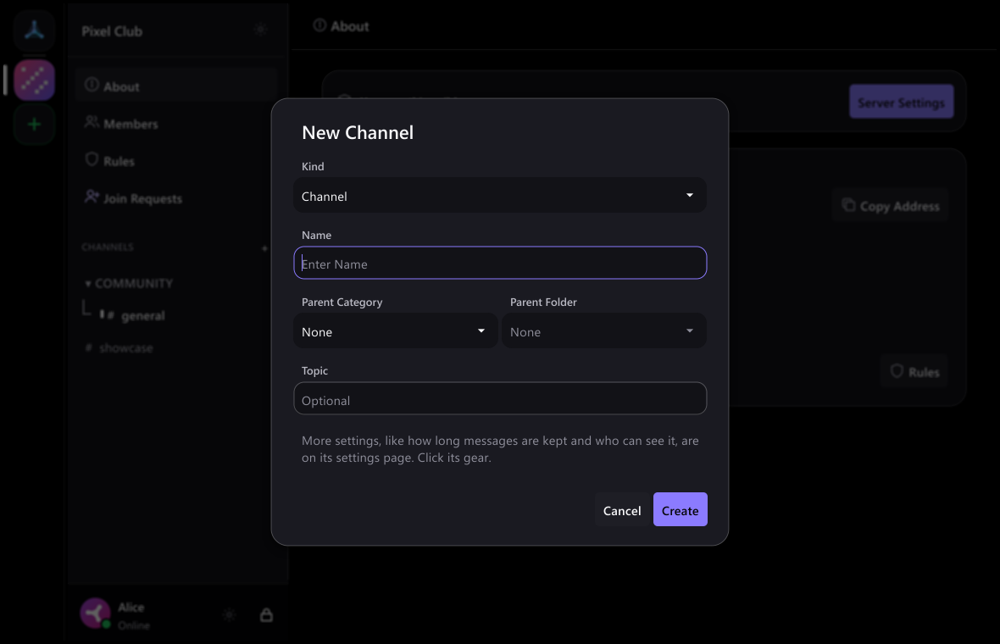

*Making a channel.*

**Parent Category** and **Parent Folder** choose where it goes (**None** puts a channel at the top). To change it later, point at it and click its **gear**: its settings page has **Overview**, **Messages** and **Permissions**, and **Delete** at the bottom. Deleting a category or folder deletes everything inside it. Under **Messages**:

| Setting | What it does |
| --- | --- |
| Past Messages | **Visible**: people who join later can read messages from before they joined. **Hidden**: they only see new ones. |
| Keep Messages | How long messages are kept (from 7 days to forever). Older ones are deleted by themselves. |

Both settings can be **Inherit**: a channel then uses the setting of the folder or category it is in.

## 15. Who can join, and members

As the owner, open Server Settings with the gear next to the guild's name. The **JOINING** group has **Joining Conditions**, **Rules** and **CAPTCHA**.

### Joining Conditions and Rules

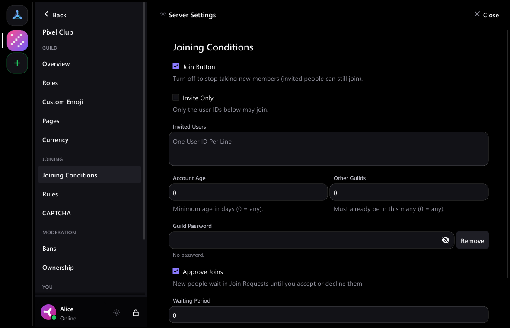

*Joining Conditions. The Rules category holds the Rules settings.*

| Setting | What it does |
| --- | --- |
| Join Button | Turn it off to stop taking new members (invited people can still join). |
| Invite Only | Only the user IDs listed under **Invited Users** may join (one per line). |
| Account Age / Other Guilds | Keeps out brand-new bot accounts. |
| Guild Password | A password to share with members. It is separate from the guild-forge password. |
| Approve Joins | Newcomers wait in **Join Requests** until you accept or decline them. |
| Waiting Period | New members can read, but can't write, react or post in Threads for this many minutes. The owner, Administrators and members with a role don't wait. |
| Rules | The rules text (Markdown); **Must Agree** (people scroll to the end and tick **I agree**), **Public Rules** (anyone with the address can read them) and **Rules Button** (a Rules button on the About page). |
| Join Button (place) | **About Page**, **Rules Page**, or **After Agreeing** to the Rules. |

### CAPTCHA

Write up to **16 questions**; each time, Nexus asks a random few of them (up to 10). Questions can have a picture, and the answer can be one choice, several choices, a dropdown, or typed text. Typed answers must match exactly: you choose whether capital letters matter, and you can accept up to 4 different answers (for example *grey* and *gray*).

Each question has a **Weightage**: **Must Always Get Right** (getting it wrong fails the questions), **Regular**, or **Shouldn't Count** (asked, but not marked). **Always ask this question.** puts it in every quiz; random others fill up the rest.

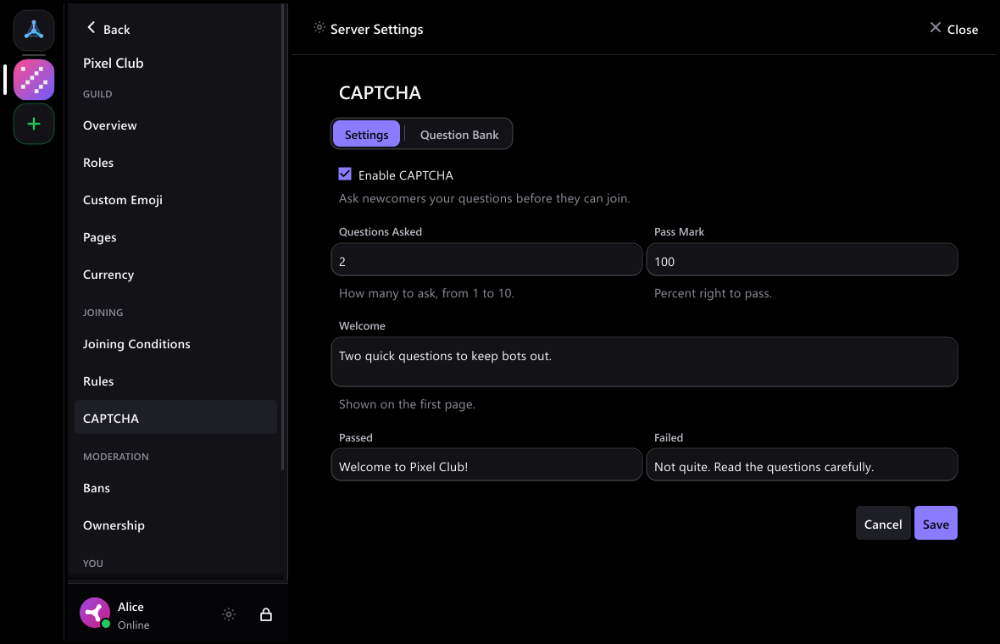

*CAPTCHA: the settings, with the Question Bank in the second tab.*

### Join Requests

When approval is on, the number next to **Join Requests** in the side bar shows how many people are waiting.

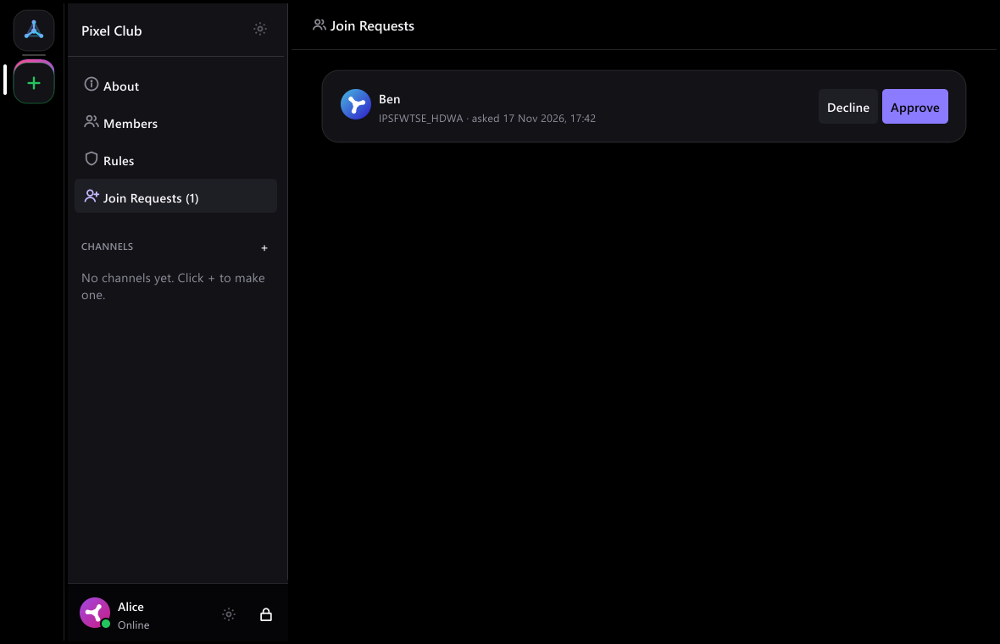

*Approve or decline each request.*

### Kicking and banning

On the **Members** page, click **⋯** next to a member. **Kick** removes them (they may join again). **Ban** stops that user from ever joining again. Tick **Block Address** to also block the internet address they used, but that can block other people who share it, such as family members. Server Settings, **Bans**, lists the bans and lets you lift them. **Timeout** silences someone for a while (1 minute to 1 week) without removing them: they can still read, but can't write, react or post until it ends. **Remove Timeout** ends it early.

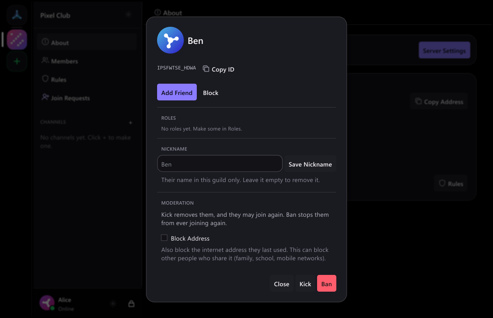

*Kick or ban a member.*

When someone leaves or is removed, the members' apps make new channel keys by themselves, so that person can't read new messages.

## 16. Roles and permissions

Roles let you share the work of running a guild. Open them in Server Settings, under **Roles** (you need the **Manage Roles** permission; the owner has every permission).

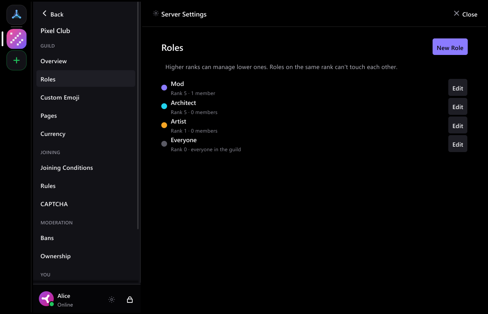

*The guild's roles, highest rank first.*

### Ranks

Every role has a **rank**. You can only manage people and roles ranked **below** your own highest role, so a Mod can't remove an Admin. Roles can share a rank: then neither can touch the other. In the picture, **Mod** looks after members and **Architect** builds channels; both are rank 5, so a Mod can't kick an Architect, and an Architect can't moderate a Mod. **Everyone** is the role all members have; it is always rank 0, and its permissions are everyone's starting point.

### Editing a role

Give a role a name, a rank, a colour (names show in the colour of their highest coloured role), and tick its permissions. **Separate Group** lists its members as their own group on the Members page; **Mentionable** lets anyone @mention it. **Purchasable** lets members buy it in the Shop (add it there as a Role item); **Accessible To** limits buying to some roles, and **Mutually Exclusive** lists roles it can't be worn with. You can only give permissions you have yourself.


*Editing the Mod role.*

| Permission | What it allows |
| --- | --- |
| Administrator | Every permission. Ranks still apply. |
| Manage Guild | Overview (name, picture, About text) and Custom Emoji. |
| Manage Roles | Make and change roles below your own, and give them to people. |
| Manage Channels | Make, change and delete channels, folders and categories. |
| Manage Joining | Joining Conditions, Rules and CAPTCHA. |
| Approve Joins | Join Requests. |
| Kick / Ban | Remove or ban people ranked below you; Bans. |
| Timeout | Silence people ranked below you for a while, without removing them. |
| View Channel, Send Messages, Add Reactions | Reading, writing and reacting. |
| Manage Messages | Delete other people's messages. |
| Connect, Speak, Stream, Moderate Voice, Priority Speaker | Joining voice channels, speaking, sharing a screen or camera, moderating voice, and being heard over others. |

### Giving someone a role

On the **Members** page, click **⋯** next to a member, tick their roles and click **Save Roles**.


*Ben's roles.*

### Permissions for one channel

A category, folder or channel can change permissions for a role: click its gear, then **Permissions**. For each role, every permission can **Inherit**, **Allow** or **Deny**. The closest rule wins: a channel's rule beats its folder's, which beats its category's. **Inherit Rules** makes a channel or folder use the rules above it instead of its own.


*A staff channel: Everyone can't see it; Mods can.*

A channel you can't view is hidden from you, and its messages are never sent to your computer. Its key is only given to those who can read it, and when someone loses access, the members' apps make a new key.

## 17. Ownership and leaving

### Transferring ownership

In Server Settings, open **Ownership** and pick a member. They must **accept**; until then, you stay the owner and can cancel the offer.

### Leaving a guild

**Leave Guild** is at the bottom of Server Settings. If you are the owner, Nexus warns you that the guild will have **no owner** until its host broadcasts it and someone pairs again. You must type the guild's name to confirm.


*Leaving as the owner.*

If an owner loses their user, the host can remove them with `guild-forge reset_owner=N` (see [Hosting a guild](#3-hosting-a-guild-with-guildforge)).

## 18. Security and privacy

| What | How it is protected |
| --- | --- |
| Your private keys | Encrypted (AES-256-GCM) with a key made from your password (PBKDF2, 600,000 rounds). Never sent anywhere. |
| App ↔ guild connection | A fresh X25519 key exchange for every connection; everything after it is encrypted with AES-256-GCM. |
| Guild identity | Each guild signs the connection with its own key. The app remembers each guild's ID and refuses to connect if it ever changes ("This may be an impostor."). |
| Messages | End-to-end encrypted with a key per channel (AES-256-GCM) and signed by their author (Ed25519). Keys are passed between members in sealed boxes that only the receiver can open; the guild never sees them. |
| Private messages | Sealed with a key only the two people share (X25519), signed by the sender, passed on by a shared guild that can't read them; kept encrypted on your computer. |
| Pairing | The one-time password is only accepted during a broadcast, for 5 minutes, with 5 tries. |
| Export files | Encrypted with the guild password. |
| Guild files on Linux | Owned by the `guild-forge` system user; other users can't read them. |
| The app's window | Drawn by Nexus itself; nothing is served over the network. |

### Things to know

- A lost user password **cannot be recovered**. Back up your user folder, and remember the password.
- A guild's host can see members' IP addresses, like any server.
- The host can't read messages, but can see who sent a message, when, and in which channel.

## 19. Troubleshooting

| Problem | What to try |
| --- | --- |
| *Check* says it could not reach the guild | Is the guild running (`guild-forge list`)? Are the address and port right? On Windows hosts, allow `guild-forge` through the firewall (Private networks). If you are testing in a virtual machine, use **Bridged** networking. |
| *Not broadcasting* | On the guild's computer: `setup=N broadcast`. Broadcasts last one hour. |
| *This guild already has an owner* | Only guilds without an owner can be paired. The host can use `reset_owner=N`. |
| Guild grey: *Active on another computer* | Click the guild → **Use Here**. |
| Guild grey: *Identity changed* | The address now answers with a different guild. Make sure you have the right address; this can be an impostor. |
| 🔒 next to a channel | Your app is waiting for the channel's key. It arrives when the owner, or another member who has it, is online. |
| *needs administrator rights on Linux* | Put `sudo` in front of the command. |
| Port is being used by another program | `setup=N port=NUMBER` with another port. |
| A guild does not start | Read its log: `<guild folder>/logs/guild.log`. On Linux, also `sudo journalctl -u 'guild-forge@*' -n 30`. |
| The build says nexus is running | Close the Nexus window and build again. |

## 20. Reference

### guild-forge commands

| Command | What it does | Password |
| --- | --- | --- |
| `create` | Create a new guild | sets it |
| `list` | Show all guilds and their state | None |
| `setup=N` + `password`, `port=`, `boot=`, `broadcast` | Password, port, start on boot, broadcast | yes |
| `start=N` / `stop=N` | Start or stop guild N | None |
| `OTP` | One-time password for the broadcasting guild | None |
| `export=N [FOLDER]` | Save guild N as an encrypted `.nexus` file | yes |
| `import=PATH` | Add a guild from a `.nexus` file or a guild folder | the file's |
| `delete=N` | Delete guild N | yes |
| `backup=N` | Save a backup of guild N | yes |
| `fall-back=N [NAME]` | List backups, or go back to backup NAME | to restore |
| `reset_owner=N` | Remove guild N's owner | yes |
| `help` | Show the list of commands | None |

Paths with spaces go in double quotes: `guild-forge import="C:\My Files\GUILD1.nexus"`.

### Where files are kept

| What | Windows | Linux |
| --- | --- | --- |
| Your user | `Documents\Nexus\<name>` (or wherever you chose) |  |
| The app's settings and log | `%APPDATA%\nexus\` | `~/.config/nexus/` |
| List of guilds (host) | `%APPDATA%\guild-forge\registry.json` | `/var/lib/guild-forge/registry.json` |
| Guild folders (default) | `%APPDATA%\guild-forge\guilds\` | `/var/lib/guild-forge/guilds/` |
| Backups | `%APPDATA%\guild-forge\backups\` | `/var/lib/guild-forge/backups/` |

### Inside a user folder

```text
Alice/
  profile.json     name, user ID, status, encrypted private keys
  contacts.json    friends
  guilds.json      guilds you are in
  reads.json       the last message you read in each channel
  media/           pictures, chat files, cached guild pictures
```
